# 游戏重建与移植 · Rebuilt Games

**简体中文** · [English](README.en.md)

发现反编译、重编译、引擎重实现与移植游戏。查看图片、运行平台和启动方式。

[游戏资源获取](RESOURCES.md) · [贡献项目](CONTRIBUTING.md)

144 个展示项目 · 86 个浏览器入口。

可直接体验的项目与需要自行构建的项目分别展示。构建条目写明平台、构建入口和原版文件要求；自行构建仍可能需要ROM或游戏数据。

## 浏览器直接运行

1. **反重力赛车 · Wipeout Rewrite**

   <a href="https://phoboslab.org/wipegame/">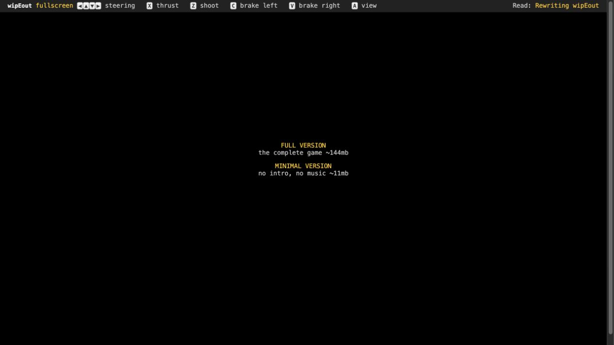</a>

   网页版本选择页 <a href="https://phoboslab.org/wipegame/">图片来源</a>

   Wipeout的C语言重写与浏览器移植，驾驶反重力赛车在未来赛道竞速。

   **平台：** 桌面浏览器

   **运行：** 打开页面，选择 FULL VERSION 或 MINIMAL VERSION；后者省略开场和音乐，约11MB。

   [**打开在线入口**](https://phoboslab.org/wipegame/) · [项目介绍](https://github.com/phoboslab/wipeout-rewrite)

2. **Cube 2 · BananaBread**

   <a href="https://kripken.github.io/BananaBread/cube2/bb.html">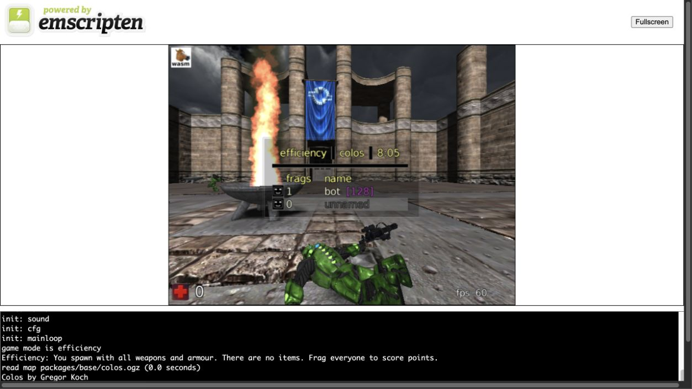</a>

   页面自动加载出的3D场景 <a href="https://kripken.github.io/BananaBread/cube2/bb.html">图片来源</a>

   基于Sauerbraten的浏览器第一人称射击演示，提供机器人对战、3D场景和地图编辑能力。

   **平台：** 桌面浏览器

   **运行：** 打开网页，等待加载完成；页面会直接显示地图和机器人对战场景。

   [**打开在线入口**](https://kripken.github.io/BananaBread/cube2/bb.html) · [项目介绍](https://github.com/kripken/BananaBread)

3. **模拟城市 · micropolisJS**

   <a href="https://www.graememcc.co.uk/micropolisJS">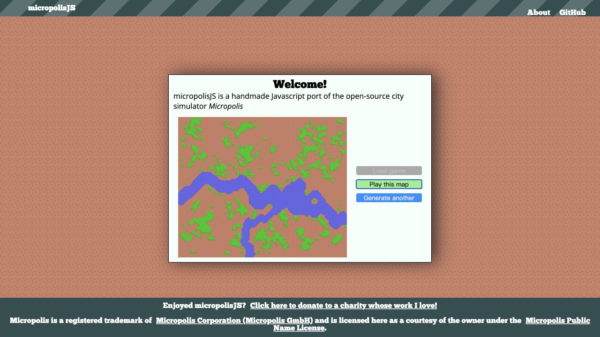</a>

   欢迎页与地图预览 <a href="https://www.graememcc.co.uk/micropolisJS">图片来源</a>

   规划住宅、商业和工业区，铺设道路与电网，平衡预算与市民需求。基于开源Micropolis的JavaScript城市模拟游戏。

   **平台：** 桌面浏览器

   **运行：** 打开网页，选择Play this map；也可先用Generate another生成另一张地图。

   [**打开在线入口**](https://www.graememcc.co.uk/micropolisJS) · [项目源码](https://github.com/graememcc/micropolisJS)

4. **弹珠爆破：黄金版 · MBHaxe**

   <a href="https://marbleblastgold.randomityguy.me">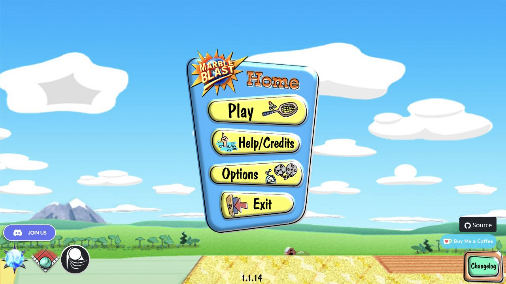</a>

   Gold主菜单 <a href="https://marbleblastgold.randomityguy.me">图片来源</a>

   操控弹珠在立体赛道上收集宝石，避开机关并赶到终点。该Haxe项目还提供Platinum、Ultra和PlatinumQuest的独立网页版。

   **平台：** 桌面与移动浏览器

   **运行：** 打开Gold在线入口，等待主菜单加载后选择Play；其他版本的入口列在下方。

   [**打开在线入口**](https://marbleblastgold.randomityguy.me) · [项目源码](https://github.com/RandomityGuy/MBHaxe) · [原版系列入口](https://marbleblast.randomityguy.me) · [Ultra版本](https://marbleblastultra.randomityguy.me) · [PlatinumQuest版本](https://platinumquest.randomityguy.me)

5. **装甲元帅风格 · Panzer Marshal**

   <a href="https://panzermarshal.com/">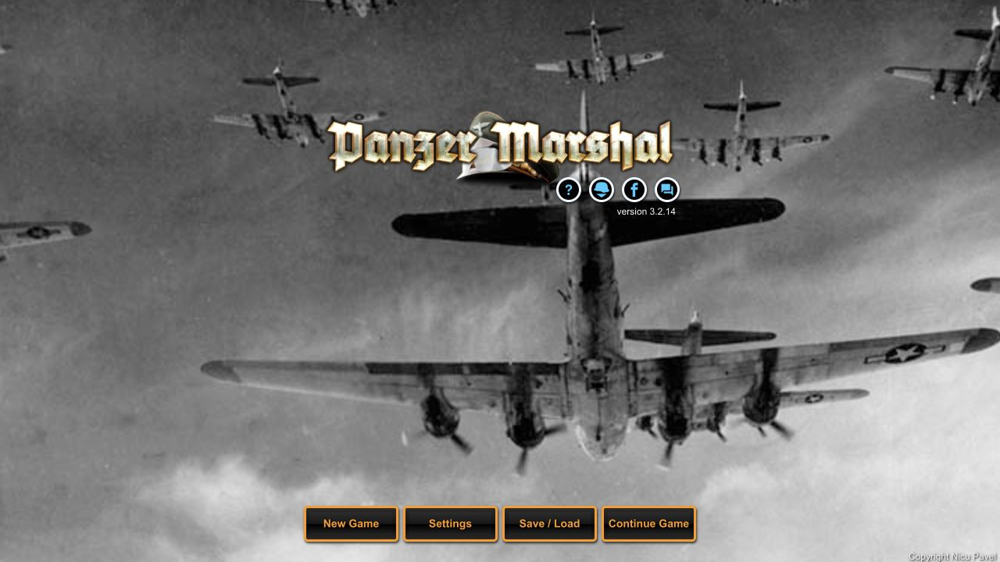</a>

   游戏主菜单 <a href="https://panzermarshal.com/">图片来源</a>

   在六角格战场上指挥步兵、坦克和飞机，争夺目标并管理补给。这是受《装甲元帅2》启发的HTML5回合制战争游戏。

   **平台：** 桌面与移动浏览器

   **运行：** 打开网页，等待Panzer Marshal主菜单出现后选择New Game。

   [**打开在线入口**](https://panzermarshal.com/) · [项目源码](https://github.com/nicupavel/openpanzer)

6. **辛普森一家：横冲直撞 · Three.js重建**

   

   作者提供的项目画面 <a href="https://github.com/Vheissu/hit-and-run-web/blob/main/README.md">图片来源</a>

   基于原版地图与任务数据的Three.js重建，在春田镇驾驶、探索并推进任务；物理与部分交互仍采用重建实现。

   **平台：** 桌面浏览器

   **运行：** 打开页面，等待载入，选择 Start 和 New Game。

   [**打开在线入口**](https://vheissu.github.io/hit-and-run-web/) · [项目介绍](https://github.com/Vheissu/hit-and-run-web)

7. **割绳子 · Cut the Rope DX**

   <a href="https://yell0wsuit.github.io/cuttherope-dx/">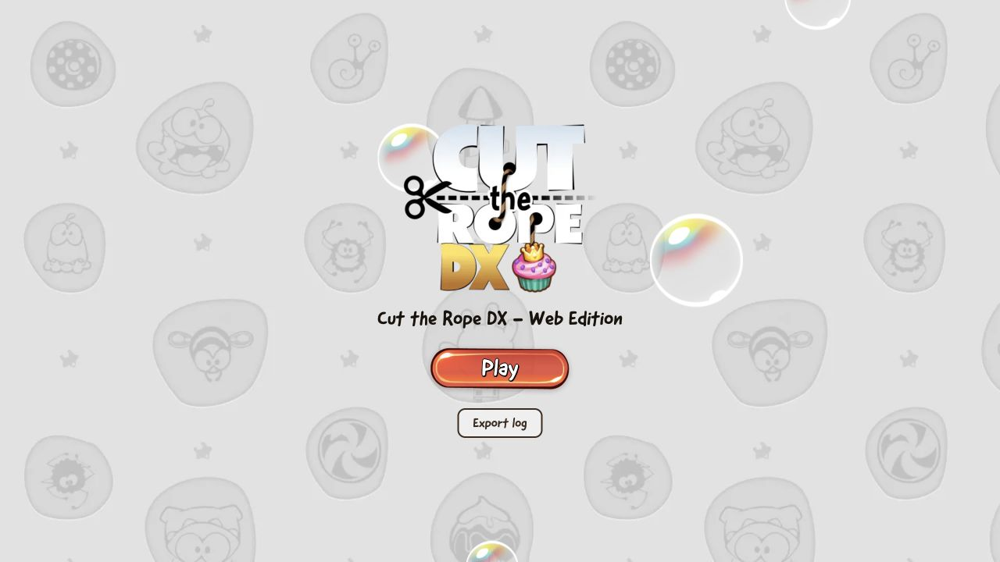</a>

   网页版启动页 <a href="https://yell0wsuit.github.io/cuttherope-dx/">图片来源</a>

   剪断绳子，让糖果穿过机关、收集星星，最后送到Om Nom嘴里。基于PC版反编译代码的增强版，增加关卡盒子并提供网页版。

   **平台：** 浏览器（WebAssembly）/ Windows / macOS（Apple Silicon）/ Linux

   **运行：** 打开在线链接，等待资源加载完成后点击Play；桌面版可在项目Releases下载对应系统版本。

   [**打开在线入口**](https://yell0wsuit.github.io/cuttherope-dx/) · [项目源码](https://github.com/yell0wsuit/cuttherope-dx)

8. **纸飞机冒险 · Aerofoil / Glider PRO**

   <a href="https://galeforcegames.itch.io/aerofoil">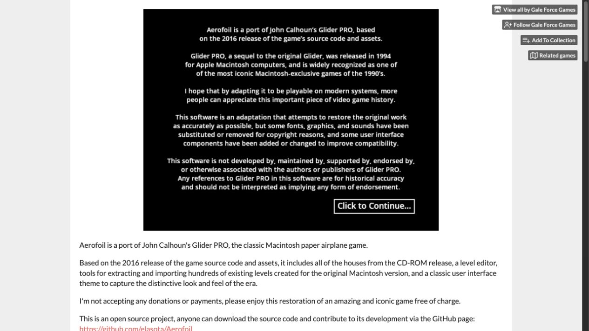</a>

   浏览器窗口中的启动介绍 <a href="https://galeforcegames.itch.io/aerofoil">图片来源</a>

   基于作者公开源码与素材的Glider PRO移植，操纵纸飞机穿过房间、利用气流并避开障碍。

   **平台：** 桌面浏览器

   **运行：** 在itch.io页面点击 Run game，阅读启动介绍后进入游戏窗口。

   [**打开在线入口**](https://galeforcegames.itch.io/aerofoil) · [项目介绍](https://github.com/elasota/Aerofoil)

9. **宝可梦：红 · Pokémon Claude Red**

   

   上游标题画面 <a href="https://raw.githubusercontent.com/levy-street/pokemon-claude-red/media/screens/title.png">图片来源</a>

   从真新镇出发，捕捉宝可梦、挑战道馆并探索关都地区。作者使用Claude重建的JavaScript版本，提供电脑与手机网页入口。

   **平台：** 桌面与移动浏览器

   **运行：** 打开在线入口，按页面提示按键启用声音并开始；无需先注册账号。

   [**打开在线入口**](https://claudered.dev) · [项目源码](https://github.com/levy-street/pokemon-claude-red)

10. **以撒的结合：忏悔+ · The Browsing of Isaac**

    

    当前页面的开场画面 <a href="https://tboi.online">图片来源</a>

    将Windows程序静态重编译为WASM的浏览器版本，提供随机地牢探索、射击与道具组合。

    **平台：** 桌面或手机浏览器

    **运行：** 打开tboi.online，等待首次载入和开场结束，再使用游戏菜单开始。

    [**打开在线入口**](https://tboi.online) · [项目介绍](https://github.com/chiikabu/the-browsing-of-isaac)

11. **模拟高尔夫 · OpenSGolf**

    

    上游游戏截图，使用原版SimGolf素材 <a href="https://github.com/crspytopgn/opensgolf/blob/main/README.md">图片来源</a>

    设计球道、经营度假村，也可亲自下场挥杆。提供免费替代素材游玩路径，可选导入自有SimGolf原版素材。

    **平台：** 桌面与移动浏览器；另有Windows / macOS / Linux / Android版本

    **运行：** 打开页面选择Play with free graphics。也可选择自己的SimGolf目录、ZIP或CD镜像；读者自行继续，原版文件仅在本机读取。

    [**打开在线入口**](https://crspytopgn.github.io/opensgolf/) · [项目源码](https://github.com/crspytopgn/opensgolf)

12. **世界黄昏 · Weltendämmerung**

    <a href="https://s-macke.github.io/weltendaemmerung/">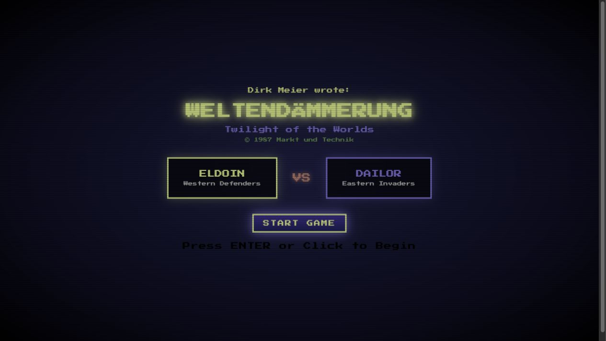</a>

    当前标题页 <a href="https://s-macke.github.io/weltendaemmerung/">图片来源</a>

    C64双人回合制策略游戏的浏览器重实现，双方指挥不同兵种，在移动、进攻和筑防阶段争夺地图。

    **平台：** 桌面浏览器

    **运行：** 打开网页，点击 START GAME 进入回合制对局。

    [**打开在线入口**](https://s-macke.github.io/weltendaemmerung/) · [项目介绍](https://github.com/s-macke/weltendaemmerung)

13. **坦克大战 · Battle City**

    <a href="https://battle-city.berrry.app">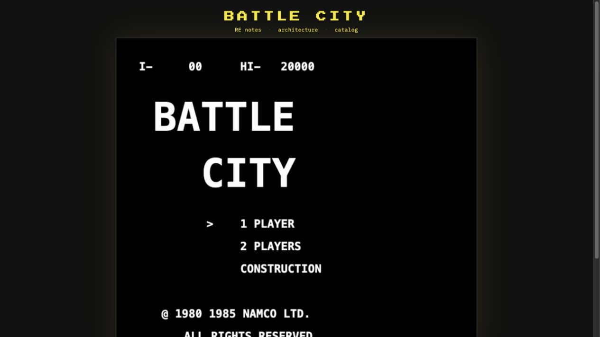</a>

    标题菜单 <a href="https://battle-city.berrry.app">图片来源</a>

    驾驶坦克守住鹰形基地，击毁敌军并利用地形周旋。基于红白机版逆向记录重实现，标题菜单提供单人、双人和关卡编辑。

    **平台：** 桌面浏览器

    **运行：** 打开网页，在标题菜单选择模式后按Enter开始。

    [**打开在线入口**](https://battle-city.berrry.app) · [项目源码](https://github.com/vgrichina/battlecity)

14. **蜗牛邮差 · Snail Mail**

    <a href="https://snail.banteg.xyz">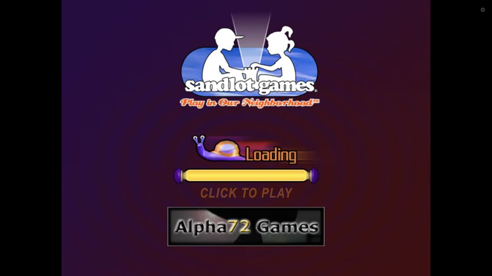</a>

    点击启动画面 <a href="https://snail.banteg.xyz">图片来源</a>

    让蜗牛Turbo沿着太空高速路送邮件，拾取包裹、躲避盐堆并消灭蛞蝓。将Windows游戏逻辑反编译后移植到WebAssembly。

    **平台：** 桌面浏览器

    **运行：** 打开网页，等待出现CLICK TO PLAY后点击画面启动。

    [**打开在线入口**](https://snail.banteg.xyz) · [项目源码](https://github.com/banteg/snail)

15. **王国保卫战：前线 · ATB HTML5**

    <a href="https://atbfun.github.io/kingdomrush/">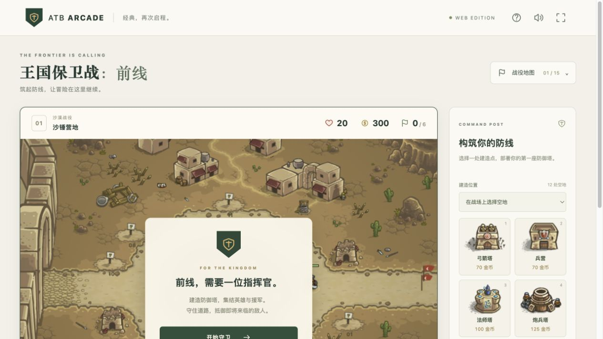</a>

    当前在线页面的启动界面 <a href="https://atbfun.github.io/kingdomrush/">图片来源</a>

    建造弓箭、兵营、法师和炮兵塔，调配英雄与技能守住道路。项目以HTML5重建原作的地图、战役与塔防机制。

    **平台：** 桌面或手机浏览器，支持鼠标与触屏

    **运行：** 打开页面后点击“开始守卫”，在空地建塔，再召唤第一波；可从“战役地图”切换关卡。

    [**打开在线入口**](https://atbfun.github.io/kingdomrush/) · [项目源码](https://github.com/atbfun/kingdomrush)

16. **Untangle：解开交叉线**

    <a href="https://az9713.github.io/untangle-rebuild/rebuild/index.html">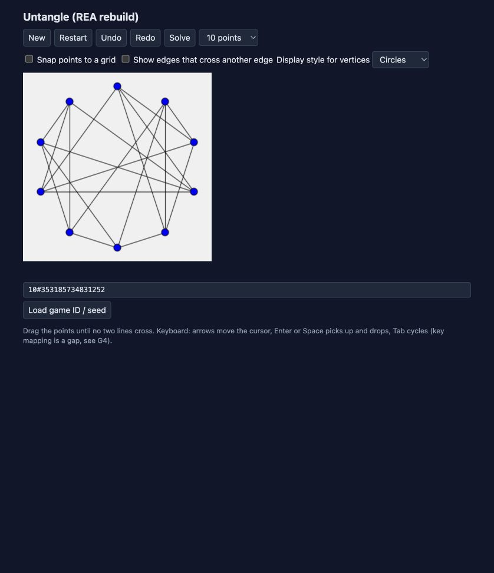</a>

    棋盘画面 <a href="https://az9713.github.io/untangle-rebuild/rebuild/index.html">图片来源</a>

    把一团交叉的连线整理成互不相交的网络。适合打开网页后快速体验的益智小游戏。

    **平台：** 桌面浏览器

    **运行：** 打开在线链接即可。

    [**打开在线入口**](https://az9713.github.io/untangle-rebuild/rebuild/index.html) · [项目源码](https://github.com/az9713/untangle-rebuild)

17. **Little Runner：恐龙速度实验**

    <a href="https://zhxunzh84.github.io/rea-dino-reverse-engineering/dino-demo.html">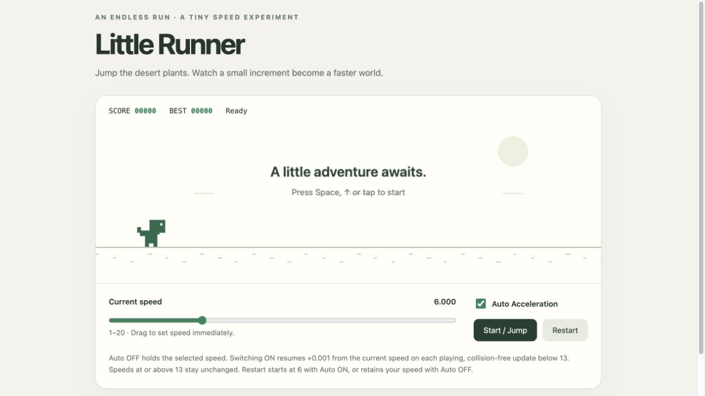</a>

    演示准备画面 <a href="https://zhxunzh84.github.io/rea-dino-reverse-engineering/dino-demo.html">图片来源</a>

    越过沙漠植物，观察速度如何逐步增加。这个独立小演示根据 REA 调查恢复速度规则，画面与部分玩法作了简化。

    **平台：** 桌面浏览器

    **运行：** 打开在线链接后开始演示。

    [**打开在线入口**](https://zhxunzh84.github.io/rea-dino-reverse-engineering/dino-demo.html) · [项目源码](https://github.com/zhxunzh84/rea-dino-reverse-engineering)

18. **反恐精英1.6 · CSJS**

    

    上游提供的在线入口预览 <a href="https://github.com/SubmitGame/awesome-decomp-games/blob/9dd80506a67217df01af09ac1ca739a95b2f519a/screenshots/browser-counter-strike-1-6.jpg">图片来源</a>

    基于Xash3D的浏览器移植，提供经典团队射击与在线服务器。

    **平台：** Windows / macOS / Linux 的桌面浏览器

    **运行：** 打开网页，关闭可选投票弹窗，在 SERVERS 中选择服务器后等待资源加载。

    [**打开在线入口**](https://csjs.live) · [项目介绍](https://csjs.live/)

19. **CS起源连跳 · bunnyhop.lol**

    

    上游提供的在线入口预览 <a href="https://github.com/SubmitGame/awesome-decomp-games/blob/9dd80506a67217df01af09ac1ca739a95b2f519a/screenshots/browser-counter-strike-source-bunnyhop-bunnyhop-lol.jpg">图片来源</a>

    重现CS起源连跳移动与计时闯关的浏览器玩法项目。

    **平台：** Windows / macOS / Linux 的桌面浏览器

    **运行：** 打开页面，按提示选择显示名，再选 PLAY 或 PLAY ONLINE。

    [**打开在线入口**](https://bunnyhop.lol) · [项目介绍](https://bunnyhop.lol/)

20. **CS起源滑翔 · Surfd**

    

    上游提供的在线入口预览 <a href="https://github.com/SubmitGame/awesome-decomp-games/blob/9dd80506a67217df01af09ac1ca739a95b2f519a/screenshots/browser-counter-strike-source-surf-surfd.jpg">图片来源</a>

    沿斜坡保持速度、完成计时赛道的浏览器Surf玩法项目。

    **平台：** Windows / macOS / Linux 的桌面浏览器

    **运行：** 打开页面，选择 Play now 加入服务器，或使用 Solo &amp; practice。

    [**打开在线入口**](https://surfd.net) · [项目介绍](https://surfd.net/)

21. **古惑狼嘉年华 · Crash Bash Online**

    

    上游提供的在线入口预览 <a href="https://github.com/SubmitGame/awesome-decomp-games/blob/9dd80506a67217df01af09ac1ca739a95b2f519a/screenshots/browser-crash-bash-online.jpg">图片来源</a>

    以搬箱子、冰面推挤和坦克对战等小游戏为主的非官方浏览器移植。

    **平台：** Windows / macOS / Linux 的桌面浏览器

    **运行：** 打开页面，等待菜单加载，选择 SOLO VS CPU 或多人对战；私人房间可分享代码。

    [**打开在线入口**](https://crashbash.app/) · [项目介绍](https://crashbash.app/)

22. **毁灭战士联机版 · Silent Space Marine**

    

    上游提供的在线入口预览 <a href="https://github.com/SubmitGame/awesome-decomp-games/blob/9dd80506a67217df01af09ac1ca739a95b2f519a/screenshots/browser-doom-multiplayer-silent-space-marine.jpg">图片来源</a>

    将Doom移植到WebAssembly，并通过Cloudflare网络提供单人和联机入口。

    **平台：** Windows / macOS / Linux 的桌面浏览器

    **运行：** 打开页面，选择 PLAY SOLO 或 START MULTIPLAYER，等待页面加载数据。

    [**打开在线入口**](https://silentspacemarine.com/) · [项目介绍](https://silentspacemarine.com/)

23. **侠盗猎车手III · WASM Arcade**

    

    上游提供的在线入口预览 <a href="https://github.com/SubmitGame/awesome-decomp-games/blob/9dd80506a67217df01af09ac1ca739a95b2f519a/screenshots/browser-grand-theft-auto-iii.jpg">图片来源</a>

    基于re3的浏览器移植，在自由城驾驶、探索并执行任务。

    **平台：** Windows / macOS / Linux 的桌面浏览器

    **运行：** 打开网页，点击 PLAY GTA III；页面按需加载并缓存数据，需要支持WebGL 2.0的浏览器。

    [**打开在线入口**](https://wasmarcade.com/gta3) · [项目介绍](https://wasmarcade.com/gta3)

24. **我的世界1.8.8 · EaglercraftX**

    

    上游提供的在线入口预览 <a href="https://github.com/SubmitGame/awesome-decomp-games/blob/9dd80506a67217df01af09ac1ca739a95b2f519a/screenshots/browser-minecraft-1-8-8-eaglercraftx.jpg">图片来源</a>

    通过EaglercraftX运行的浏览器沙盒移植，采矿、建造与生存。

    **平台：** Windows / macOS / Linux 的桌面浏览器

    **运行：** 点击 PLAY MINECRAFT，等待WebAssembly加载；存档保存在当前浏览器。

    [**打开在线入口**](https://wasmarcade.com/minecraft) · [项目介绍](https://wasmarcade.com/minecraft)

25. **亡者之夜 · Zombies Browser Edition**

    

    上游提供的在线入口预览 <a href="https://github.com/SubmitGame/awesome-decomp-games/blob/9dd80506a67217df01af09ac1ca739a95b2f519a/screenshots/browser-nacht-der-untoten.jpg">图片来源</a>

    以Nacht der Untoten为背景的非官方僵尸生存浏览器项目。

    **平台：** Windows / macOS / Linux 的桌面浏览器

    **运行：** 原链接会跳转到 zombies.concentric.live，跳过介绍后按页面菜单进入。

    [**打开在线入口**](https://zombies.concentric.live/) · [项目介绍](https://zombies.bitcoinsapi.com)

26. **实况足球6 · PES 6 Web Online**

    

    上游提供的在线入口预览 <a href="https://github.com/SubmitGame/awesome-decomp-games/blob/9dd80506a67217df01af09ac1ca739a95b2f519a/screenshots/browser-pro-evolution-soccer-6.jpg">图片来源</a>

    项目页面标明为PSP版PES6的浏览器重编译移植，提供足球比赛与联机入口。

    **平台：** Windows / macOS / Linux 的桌面浏览器

    **运行：** 打开页面等待数据加载，在游戏内选择比赛；支持触屏界面，桌面浏览器也可运行。

    [**打开在线入口**](https://pes6.optijuegos.net) · [项目介绍](https://pes6.optijuegos.net)

27. **雷神之锤II · Pieter 浏览器版**

    

    上游提供的在线入口预览 <a href="https://github.com/SubmitGame/awesome-decomp-games/blob/9dd80506a67217df01af09ac1ca739a95b2f519a/screenshots/browser-quake-ii.jpg">图片来源</a>

    基于FTE引擎的非官方浏览器多人竞技移植。

    **平台：** Windows / macOS / Linux 的桌面浏览器

    **运行：** 填写昵称并点击 PLAY，等待数据加载后进入多人游戏。

    [**打开在线入口**](https://q2.pieter.com) · [项目介绍](https://q2.pieter.com)

28. **QuakeWorld · Pieter 浏览器版**

    

    上游提供的在线入口预览 <a href="https://github.com/SubmitGame/awesome-decomp-games/blob/9dd80506a67217df01af09ac1ca739a95b2f519a/screenshots/browser-quakeworld.jpg">图片来源</a>

    通过FTE QuakeWorld提供低延迟多人竞技的浏览器移植。

    **平台：** Windows / macOS / Linux 的桌面浏览器

    **运行：** 输入昵称并点击 PLAY，等待浏览器加载游戏数据。

    [**打开在线入口**](https://q1.pieter.com) · [项目介绍](https://q1.pieter.com)

29. **重返德军总部 · Pieter 多人版**

    

    上游提供的在线入口预览 <a href="https://github.com/SubmitGame/awesome-decomp-games/blob/9dd80506a67217df01af09ac1ca739a95b2f519a/screenshots/browser-return-to-castle-wolfenstein.jpg">图片来源</a>

    基于iortcw与Wwasm的浏览器多人移植，提供团队对战。

    **平台：** Windows / macOS / Linux 的桌面浏览器

    **运行：** 输入昵称后点击 PLAY；页面建议桌面Chrome，首次加载约380MB并缓存。

    [**打开在线入口**](https://rtcw.pieter.com) · [项目介绍](https://rtcw.pieter.com)

30. **RuneScape Classic · 社区浏览器服**

    

    上游提供的在线入口预览 <a href="https://github.com/SubmitGame/awesome-decomp-games/blob/9dd80506a67217df01af09ac1ca739a95b2f519a/screenshots/browser-runescape-classic.jpg">图片来源</a>

    提供经典地图、任务与技能的非官方社区浏览器版本。

    **平台：** Windows / macOS / Linux 的桌面浏览器

    **运行：** 等待首页加载，选择世界并按 Pick a username 设置账号进入；第三方登录和钱包选项为可选。

    [**打开在线入口**](https://runescapeclassic.gold/) · [项目介绍](https://runescapeclassic.gold)

31. **超级马力欧僵尸 · Super Mario Zombies**

    

    上游提供的在线入口预览 <a href="https://github.com/SubmitGame/awesome-decomp-games/blob/9dd80506a67217df01af09ac1ca739a95b2f519a/screenshots/browser-super-mario-zombies.jpg">图片来源</a>

    结合马力欧主题与Black Ops僵尸生存玩法的粉丝浏览器项目。

    **平台：** Windows / macOS / Linux 的桌面浏览器

    **运行：** 页面先要求确认拥有 Call of Duty: Black Ops，符合条件后由读者继续并选择地图。

    [**打开在线入口**](https://smz.fun/) · [项目介绍](https://smz.fun)

32. **辛普森一家：横冲直撞 · WASM**

    

    上游提供的在线入口预览 <a href="https://github.com/SubmitGame/awesome-decomp-games/blob/9dd80506a67217df01af09ac1ca739a95b2f519a/screenshots/browser-the-simpsons-hit-run.jpg">图片来源</a>

    The Simpsons: Hit &amp; Run的浏览器WASM入口，以驾驶和任务探索为主。

    **平台：** Windows / macOS / Linux 的桌面浏览器

    **运行：** 打开页面，按 Play 启动加载；使用支持WebAssembly的桌面浏览器。

    [**打开在线入口**](https://shar-wasm.cjoseph.workers.dev/?skipmovie) · [项目介绍](https://shar-wasm.cjoseph.workers.dev/?skipmovie)

33. **Urban Terror · Pieter 浏览器版**

    

    上游提供的在线入口预览 <a href="https://github.com/SubmitGame/awesome-decomp-games/blob/9dd80506a67217df01af09ac1ca739a95b2f519a/screenshots/browser-urban-terror-listed-as-unreal-tournament.jpg">图片来源</a>

    将ioUrbanTerror移植到WebAssembly的团队射击入口；不是Unreal Tournament。

    **平台：** Windows / macOS / Linux 的桌面浏览器

    **运行：** 填写昵称点击 PLAY；页面建议桌面Chrome，首次按需加载并缓存游戏数据。

    [**打开在线入口**](https://ut.pieter.com) · [项目介绍](https://ut.pieter.com)

34. **Claude of Duty：Vibe Slops II · 镜像**

    

    上游提供的在线入口预览 <a href="https://github.com/SubmitGame/awesome-decomp-games/blob/9dd80506a67217df01af09ac1ca739a95b2f519a/screenshots/browser-claude-of-duty-vibe-slops-ii-froydinger-mirror.jpg">图片来源</a>

    基于Three.js重建Black Ops II的Hijacked地图射击玩法，原作者为Luckey Faraday。

    **平台：** Windows / macOS / Linux 的桌面浏览器

    **运行：** 打开镜像，点击 TAP OR CLICK TO LOAD，等待地图加载；另附备用镜像。

    [**打开在线入口**](https://froydinger.github.io/claude-of-duty/) · [项目介绍](https://github.com/luckeyfaraday/claude-of-duty) · [备用镜像](https://goofyahhbro69420.github.io/Black-Ops-2)

35. **Kino der Toten · 浏览器镜像**

    

    上游提供的在线入口预览 <a href="https://github.com/SubmitGame/awesome-decomp-games/blob/9dd80506a67217df01af09ac1ca739a95b2f519a/screenshots/browser-kino-der-toten-goofyahhbro69420-mirror.jpg">图片来源</a>

    由Luckey Faraday重建的Black Ops僵尸剧院单人生存玩法；保留可访问的镜像入口。

    **平台：** Windows / macOS / Linux 的桌面浏览器

    **运行：** 等待地图与装备加载后选择 ENTER THE THEATER。

    [**打开在线入口**](https://goofyahhbro69420.github.io/COD-ZOMBIES/) · [项目介绍](https://github.com/luckeyfaraday/kino-der-toten)

36. **祖玛 · ATB HTML5**

    <a href="https://atbfun.github.io/zuma/">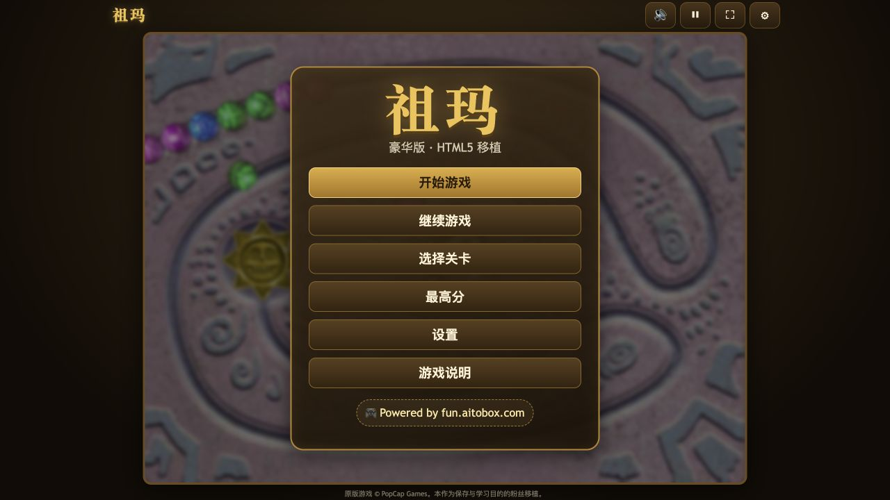</a>

    当前在线页面的启动界面 <a href="https://atbfun.github.io/zuma/">图片来源</a>

    发射彩色球，凑齐同色球消除珠链，阻止它们滚入终点。页面标示为《祖玛：豪华版》的HTML5粉丝移植。

    **平台：** 桌面浏览器

    **运行：** 打开页面后点击“开始游戏”；也可在“选择关卡”中挑选关卡。

    [**打开在线入口**](https://atbfun.github.io/zuma/) · [项目源码](https://github.com/atbfun/zuma)

37. **割绳子 · ATB HTML5**

    

    当前在线页面的启动界面 <a href="https://atbfun.github.io/cutrope/">图片来源</a>

    划断绳索，让糖果收集星星并落入Om Nom嘴里。项目将原Flash版的50个关卡迁移到HTML5，提供两章关卡与本地进度保存。

    **平台：** 桌面或手机浏览器，支持鼠标与触屏

    **运行：** 打开页面后点击“开始喂食”，也可通过“选择关卡”切换章节与关卡。

    [**打开在线入口**](https://atbfun.github.io/cutrope/) · [项目源码](https://github.com/atbfun/cutrope)

38. **虚拟佐特尔梅尔 · Virtueel Zoetermeer**

    

    作者原帖项目预览 <a href="https://x.com/BvdBijl/status/2113601796438737023">图片来源</a>

    重建荷兰佐特尔梅尔的城市建设游戏。作者将2000年代初的旧作品重建为浏览器WASM版本。

    **平台：** 桌面浏览器 / WebAssembly

    **运行：** 打开作者在线入口；页面会加载游戏数据。

    [**打开在线入口**](https://virtueelzoetermeer.bou.ke/) · [项目介绍](https://github.com/bouk/virtueel-zoetermeer)

39. **F1 06 · 网页版**

    

    上游目录提供的游戏预览 <a href="https://recompiledgames.com/img/games/f1-06-recompiled.jpg">图片来源</a>

    参加2006赛季的一级方程式赛车比赛。以WebAssembly和WebGPU在浏览器中运行PS2作品。

    **平台：** 支持WebGPU的桌面Chrome / Edge

    **运行：** 打开页面，等待Ready to play后选择Play；首次会按需加载游戏数据。

    [**打开在线入口**](https://f12006.online/) · [项目介绍](https://f12006.online/)

40. **NBA 2K12 · 网页版**

    

    上游目录提供的游戏预览 <a href="https://recompiledgames.com/img/games/nba-2k12-recompiled.jpg">图片来源</a>

    选择NBA球队，在球场上运球、传球与投篮。PS2作品的浏览器移植入口。

    **平台：** 支持WebGPU的桌面Chrome / Edge

    **运行：** 打开页面，等待Ready to play后选择Play；首次会按需加载游戏数据。

    [**打开在线入口**](https://nba2k12.online/) · [项目介绍](https://nba2k12.online/)

41. **极限滑雪3 · SSX 3**

    

    上游目录提供的游戏预览 <a href="https://recompiledgames.com/img/games/ssx-3-recompiled.jpg">图片来源</a>

    从雪山高速滑下，在赛道与跳台上完成花式动作。PS2作品的浏览器移植入口。

    **平台：** 支持WebGPU的桌面Chrome / Edge

    **运行：** 打开页面，等待Ready to play后选择Play；首次会按需加载游戏数据。

    [**打开在线入口**](https://ssx3.online/) · [项目介绍](https://ssx3.online/)

42. **铁拳5 · 网页版**

    

    上游目录提供的标题预览 <a href="https://recompiledgames.com/img/games/tekken-5-recompiled.jpg">图片来源</a>

    参加铁拳格斗大赛，选择角色进行3D对战。PS2版本通过浏览器运行。

    **平台：** 支持WebGPU的桌面Chrome / Edge

    **运行：** 打开页面，等待Ready to play后选择Play；首次会按需加载游戏数据。

    [**打开在线入口**](https://tekken5.online/) · [项目介绍](https://tekken5.online/)

43. **WWE SmackDown! vs. RAW · 网页版**

    

    上游目录提供的游戏预览 <a href="https://recompiledgames.com/img/games/wwe-smackdown-vs-raw-recompiled.jpg">图片来源</a>

    选择WWE选手，在摔角擂台中展开对抗。PS2作品的浏览器移植入口。

    **平台：** 支持WebGPU的桌面Chrome / Edge

    **运行：** 打开页面，等待Ready to play后选择Play；首次会按需加载游戏数据。

    [**打开在线入口**](https://smackdownvsraw.online/) · [项目介绍](https://smackdownvsraw.online/)

44. **黑色行动僵尸 · Vel.gg**

    

    上游目录提供的游戏预览 <a href="https://recompiledgames.com/img/games/black-ops-zombies-recompiled.jpg">图片来源</a>

    选择地图进行僵尸波次生存，提供单人和多人设置。

    **平台：** 桌面浏览器

    **运行：** 设置昵称、单人/多人和画质，再选择地图；网页会加载对应资源。

    [**打开在线入口**](https://vel.gg/bsz) · [项目介绍](https://vel.gg/bsz)

## 浏览器演示

45. **暗黑破坏神 · Diablo Web演示版**

    <a href="https://d07riv.github.io/diabloweb/">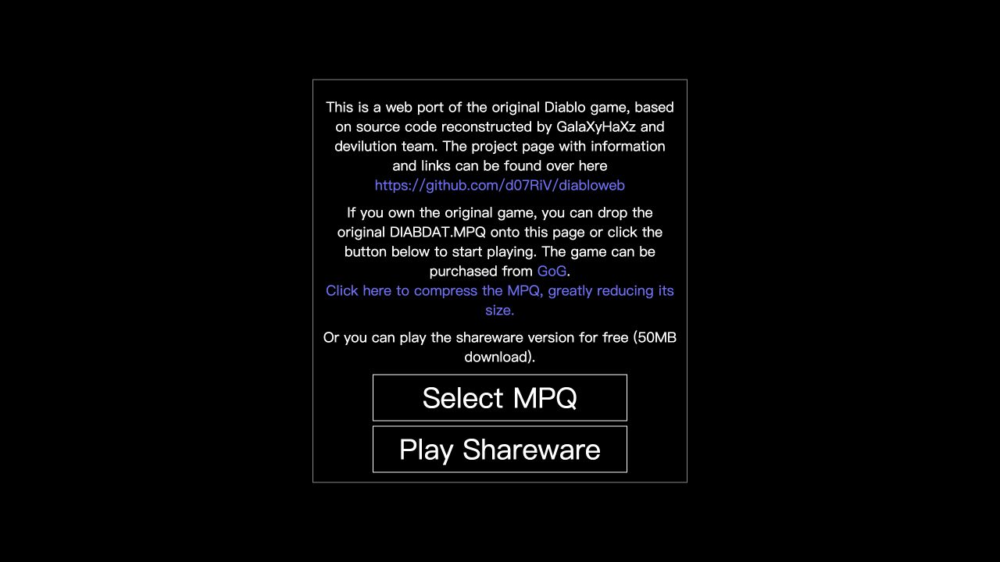</a>

    文件选择与演示入口 <a href="https://d07riv.github.io/diabloweb/">图片来源</a>

    在浏览器体验初代暗黑的Shareware演示内容。页面提供演示数据下载；完整游戏另需原版文件。

    **平台：** 浏览器

    **运行：** 打开网页，选择Play shareware并等待约50MB演示数据加载。

    **所需文件：** 完整版需自己的 DIABDAT.MPQ。

    [**打开在线入口**](https://d07riv.github.io/diabloweb/) · [项目源码](https://github.com/d07RiV/diabloweb) · [演示版资源入口](https://d07riv.github.io/diabloweb/)

46. **小小大冒险1/2 · 探索演示**

    

    作者提供的项目画面 <a href="https://github.com/LBALab/lba2remake/blob/master/README.md">图片来源</a>

    使用TypeScript与Three.js重实现冒险游戏，可探索岛屿和建筑；这是尚不能完整通关的演示。

    **平台：** 桌面浏览器

    **运行：** 打开演示页，阅读说明后进入；本地运行可按README导入自己的原版目录。

    [**打开在线入口**](https://lba2remake.net/) · [项目介绍](https://github.com/LBALab/lba2remake)

47. **横扫千军 · Nanolathe**

    

    上游引擎演示画面 <a href="https://github.com/nanolathe-gg/nanolathe">图片来源</a>

    指挥机器人军团建造基地、争夺资源。浏览器演示包含原版演示的三关，完整游戏还可使用自有数据运行。

    **平台：** 桌面Chrome / Edge / Safari；原生Windows / macOS / Linux

    **运行：** 打开三关演示；首次启动会获取演示数据。原生版按官网安装说明构建并选择游戏目录。

    **所需文件：** 完整游戏需要自己的Total Annihilation安装目录及HPI数据。

    [**打开在线入口**](https://nanolathe.gg/play/) · [项目源码](https://github.com/nanolathe-gg/nanolathe)

48. **雷神之锤II · Qwasm2**

    <a href="https://qwasm2.m-h.org.uk/">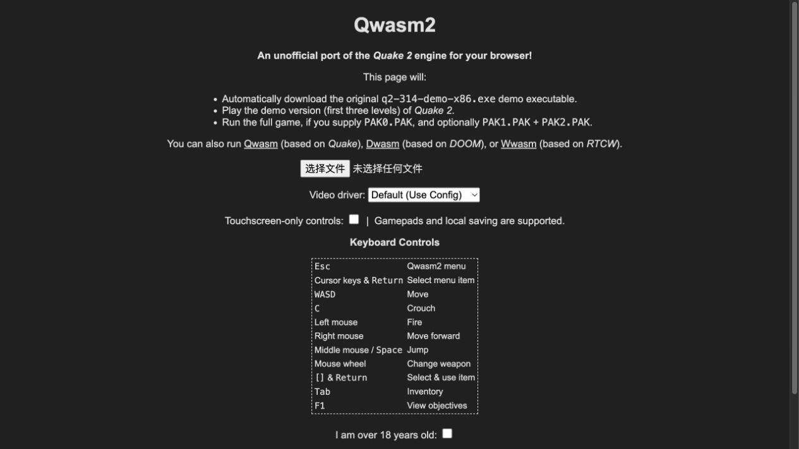</a>

    当前演示启动/加载页 <a href="https://qwasm2.m-h.org.uk/">图片来源</a>

    基于Yamagi Quake II的浏览器移植，在线演示覆盖前三关。

    **平台：** 桌面浏览器

    **运行：** 符合页面年龄要求后点击 Start Qwasm2，等待演示资源加载。

    **所需文件：** 完整版需自己的 PAK0.PAK，其他PAK与扩展按项目说明准备。

    [**打开在线入口**](https://qwasm2.m-h.org.uk/) · [项目介绍](https://github.com/GMH-Code/Qwasm2)

49. **雷神之锤 · Qwasm**

    <a href="https://qwasm.m-h.org.uk/">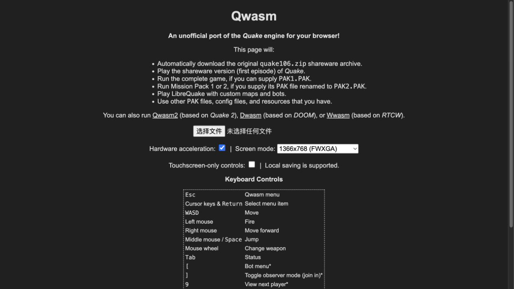</a>

    当前演示启动/加载页 <a href="https://qwasm.m-h.org.uk/">图片来源</a>

    Quake的浏览器移植，Shareware可体验第一章，也提供LibreQuake入口。

    **平台：** 桌面浏览器

    **运行：** 符合页面年龄要求后按 Start Qwasm；页面会获取Shareware。

    **所需文件：** 完整版需要自己的 PAK1.PAK；资料片需要相应PAK文件。

    [**打开在线入口**](https://qwasm.m-h.org.uk/) · [项目介绍](https://github.com/GMH-Code/Qwasm)

50. **阿克斯之城 · Arxwasm演示**

    <a href="https://wasm.continuation-labs.com/arxdemo/">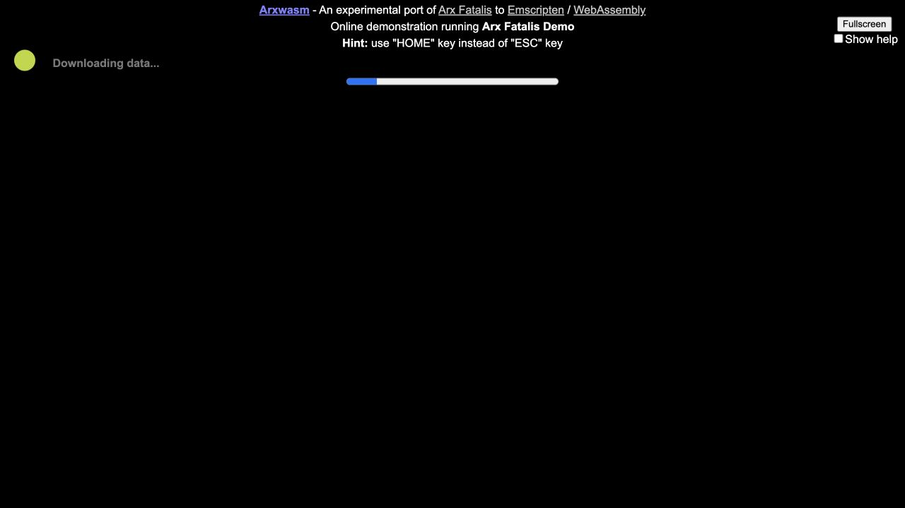</a>

    当前演示启动/加载页 <a href="https://wasm.continuation-labs.com/arxdemo/">图片来源</a>

    Arx Libertatis的实验性WASM移植，使用Arx Fatalis演示版，体验地下城探索、战斗和施法。

    **平台：** 桌面浏览器

    **运行：** 打开演示页等待载入；作者说明首次资源约150MB，推荐桌面浏览器。

    [**打开在线入口**](https://wasm.continuation-labs.com/arxdemo/) · [项目介绍](https://github.com/gabrielcuvillier/arxwasm)

51. **毁灭战士 · Dwasm**

    <a href="https://dwasm.m-h.org.uk/">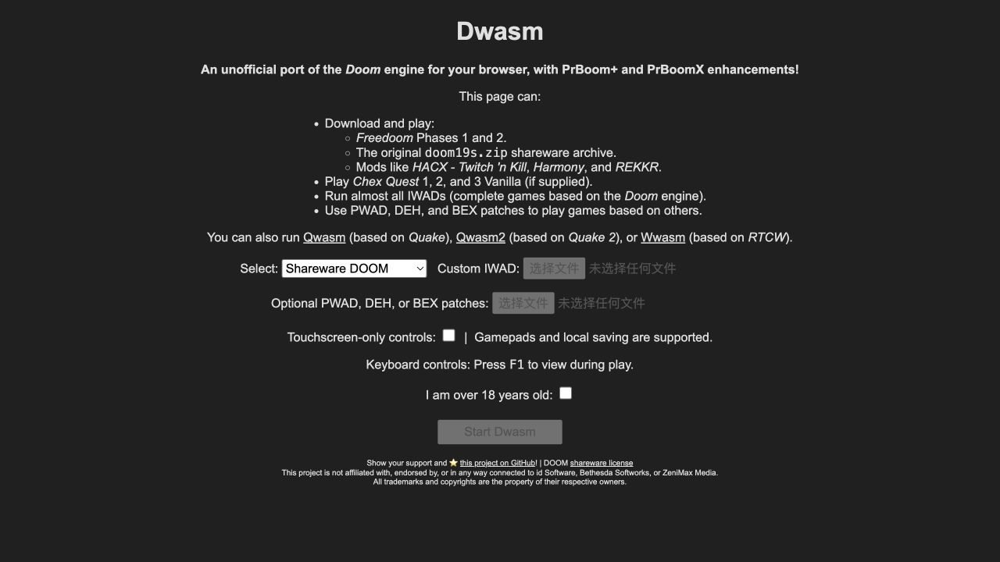</a>

    当前演示启动/加载页 <a href="https://dwasm.m-h.org.uk/">图片来源</a>

    基于PrBoom+ / PrBoomX的浏览器移植，可选择Doom Shareware、Freedoom及其他受支持作品。

    **平台：** 桌面浏览器

    **运行：** 选择Shareware DOOM或Freedoom，符合页面年龄要求的读者确认后按 Start Dwasm。

    **所需文件：** 运行自己的完整版或模组时，需准备对应IWAD及补丁文件。

    [**打开在线入口**](https://dwasm.m-h.org.uk/) · [项目介绍](https://github.com/GMH-Code/Dwasm)

52. **重返德军总部 · Wwasm**

    <a href="https://wwasm.m-h.org.uk/">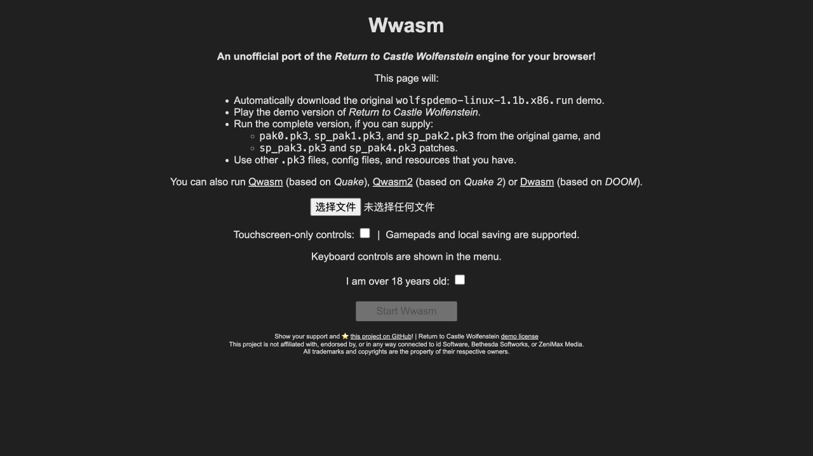</a>

    当前演示启动/加载页 <a href="https://wwasm.m-h.org.uk/">图片来源</a>

    基于iortcw的浏览器移植，提供单人演示版启动入口。

    **平台：** 桌面浏览器

    **运行：** 符合页面年龄要求后按 Start Wwasm，页面自动取得演示数据。

    **所需文件：** 完整版需自己的 pak0.pk3、sp_pak1.pk3、sp_pak2.pk3及所需更新包。

    [**打开在线入口**](https://wwasm.m-h.org.uk/) · [项目介绍](https://github.com/GMH-Code/Wwasm)

53. **暗黑破坏神 · Diablo Web（JohnImril）**

    

    上游提供的在线入口预览 <a href="https://github.com/SubmitGame/awesome-decomp-games/blob/9dd80506a67217df01af09ac1ca739a95b2f519a/screenshots/browser-diablo.jpg">图片来源</a>

    基于已有WASM引擎的现代浏览器客户端，探索地牢、战斗并收集装备；提供限量Shareware演示。

    **平台：** Windows / macOS / Linux 的桌面浏览器

    **运行：** 选择 Play Free Demo，等待演示数据加载；完整版使用 Load Your MPQ。

    **所需文件：** 完整版需要自己的 DIABDAT.MPQ。

    [**打开在线入口**](https://johnimril.github.io/diablo_web/) · [项目介绍](https://github.com/JohnImril/diablo_web)

54. **半条命 · WebXash 演示版**

    

    上游提供的在线入口预览 <a href="https://github.com/SubmitGame/awesome-decomp-games/blob/9dd80506a67217df01af09ac1ca739a95b2f519a/screenshots/browser-half-life-and-counter-strike-1-6-webxash.jpg">图片来源</a>

    通过Xash3D运行半条命；提供Uplink、Day One等演示入口，也支持自己的半条命与CS文件。

    **平台：** Windows / macOS / Linux 的桌面浏览器

    **运行：** 在 HALF-LIFE DEMOS 选择一个演示，再按 Start Demo；完整版用 Open game Folder 或 Open ZIP。

    **所需文件：** 完整版需自己的 valve / cstrike 等游戏目录。

    [**打开在线入口**](https://x8bitrain.github.io/webXash/) · [项目介绍](https://github.com/x8BitRain/webXash)

55. **雷神之锤 · NetQuake.io**

    

    上游提供的在线入口预览 <a href="https://github.com/SubmitGame/awesome-decomp-games/blob/9dd80506a67217df01af09ac1ca739a95b2f519a/screenshots/browser-netquake-io.jpg">图片来源</a>

    在浏览器中探索关卡并射击敌人；第一章可免费体验，其他章节需原版数据。

    **平台：** Windows / macOS / Linux 的桌面浏览器

    **运行：** 选择 PLAY NOW 或 SINGLEPLAYER 体验第一章；多人模式使用 MULTIPLAYER。

    **所需文件：** 解锁全部四章需自己的 pak1.pak。

    [**打开在线入口**](https://www.netquake.io/) · [项目介绍](https://www.netquake.io/)

56. **雷神之锤III竞技场 · Q3JS**

    

    上游提供的在线入口预览 <a href="https://github.com/SubmitGame/awesome-decomp-games/blob/9dd80506a67217df01af09ac1ca739a95b2f519a/screenshots/quake-iii-arena.jpg">图片来源</a>

    将ioquake3移植到浏览器，使用站点说明中的官方演示数据进行竞技对战；另附Pieter部署入口。

    **平台：** Windows / macOS / Linux 的桌面浏览器

    **运行：** 在 SERVERS 选择服务器并等待加载；Pieter入口可填写昵称后点击 PLAY。

    [**打开在线入口**](https://q3js.com/) · [项目介绍](https://q3js.com/) · [Pieter 部署](https://q3.pieter.com)

## 浏览器运行 · 已提供游戏资源入口

57. **红色警戒2 · Chrono Divide**

    

    上游提供的在线入口预览 <a href="https://github.com/SubmitGame/awesome-decomp-games/blob/9dd80506a67217df01af09ac1ca739a95b2f519a/screenshots/browser-command-conquer-red-alert-2.jpg">图片来源</a>

    建造基地、采集矿石并指挥军队对战的浏览器引擎重实现，以多人模式为主。

    **平台：** Windows / macOS / Linux 的桌面浏览器

    **运行：** 打开入口，按资源导入页的 Download 获取其预填的数据包，或导入自己的 .mix 文件，再进入游戏。

    **所需文件：** 需要红警2资源；页面提供具体下载地址，也支持自己的安装目录或压缩包。

    [**打开在线入口**](https://game.chronodivide.com/) · [项目介绍](https://chronodivide.com/) · [资源获取](https://archive.org/download/red-alert-2-multiplayer/Red-Alert-2-Multiplayer.exe)

58. **侠盗猎车手：罪恶都市 · Joncode WASM**

    

    上游提供的在线入口预览 <a href="https://github.com/SubmitGame/awesome-decomp-games/blob/9dd80506a67217df01af09ac1ca739a95b2f519a/screenshots/browser-grand-theft-auto-vice-city.jpg">图片来源</a>

    基于reVC的浏览器移植，提供罪恶都市的开放世界驾驶与动作玩法。

    **平台：** Windows / macOS / Linux 的桌面浏览器

    **运行：** 按页面链接取得 game.tar.gz，选择压缩包导入，完成后点击开始游戏；数据保存在当前浏览器。

    **所需文件：** 需要约668MB的 game.tar.gz 及解压存储空间；页面有具体下载链接，项目要求拥有正版游戏。

    [**打开在线入口**](https://joncodeofficial.github.io/gta-vice-city-wasm/) · [项目介绍](https://github.com/joncodeofficial/gta-vice-city-wasm) · [资源获取](https://gtavc-assets-proxy.joncode.workers.dev/)

## 下载安装后运行

59. **OpenRA：红警、命令与征服、沙丘2000**

    <a href="https://www.openra.net/download/">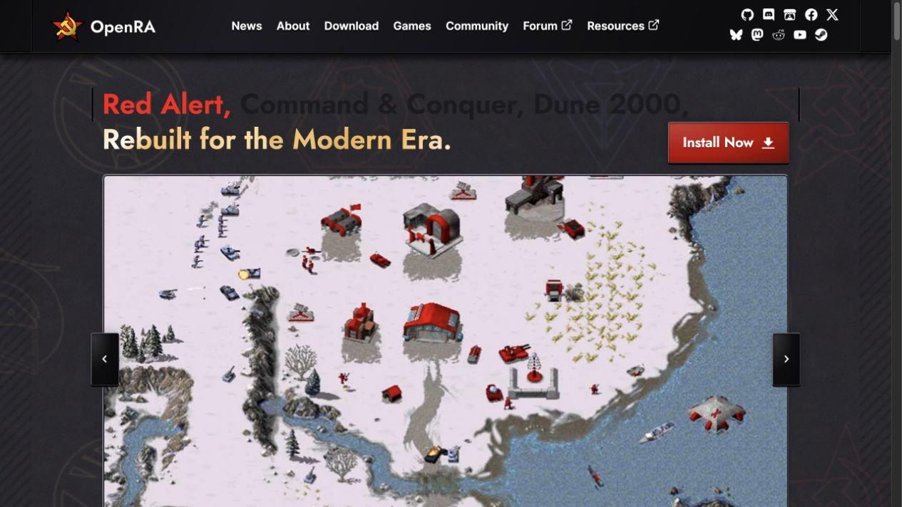</a>

    官网游戏预览 <a href="https://www.openra.net/">图片来源</a>

    重建经典即时战略游戏的引擎，提供现代操作、战役与联机。

    **平台：** Windows / macOS / Linux

    **运行：** 从官网下载对应系统安装包，首次运行选择游戏，并按提示下载所需基础素材。

    [**下载与运行说明**](https://www.openra.net/download/) · [项目源码](https://github.com/OpenRA/OpenRA) · [资源获取](https://www.openra.net/about/)

60. **运输大亨 · OpenTTD**

    

    上游项目预览 <a href="https://i.ytimg.com/vi/ZBzRh6lD9J8/maxresdefault.jpg">图片来源</a>

    铺设铁路与公路，经营运输网络；可使用免费的替代图像、音乐和音效。

    **平台：** Windows / macOS / Linux

    **运行：** 从官网下载并安装，首次运行下载OpenGFX；音效和音乐可在游戏内下载OpenSFX、OpenMSX。

    [**下载与运行说明**](https://www.openttd.org/downloads/openttd-releases/latest) · [项目源码](https://github.com/OpenTTD/OpenTTD) · [资源获取](https://www.openttd.org/downloads/opengfx-releases/latest)

61. **战争地带2100 · Warzone 2100**

    

    上游项目预览 <a href="https://repository-images.githubusercontent.com/1084181/ad379400-913f-11eb-8e30-85f3134ab00e">图片来源</a>

    研究科技、设计战车并建设基地，提供战役、遭遇战与多人模式。

    **平台：** Windows / macOS / Linux

    **运行：** 从官方发布页下载并安装对应系统版本，安装完成后直接启动。

    [**下载与运行说明**](https://wz2100.net/) · [项目源码](https://github.com/Warzone2100/warzone2100)

62. **英雄无敌II · fheroes2**

    

    作者提供的项目画面 <a href="https://github.com/ihhub/fheroes2/blob/master/README.md">图片来源</a>

    英雄无敌II引擎重实现，进行回合制地图探索、城堡经营与战术战斗；安装器可取得英文演示版。

    **平台：** Windows / macOS / Linux

    **运行：** 按安装指南下载系统对应版本；选择下载演示数据，或导入自己的完整版资源后运行。

    **所需文件：** 运行完整版需自己的Heroes II Data、Maps等目录。

    [**下载与运行说明**](https://github.com/ihhub/fheroes2/blob/master/README.md) · [项目介绍](https://github.com/ihhub/fheroes2) · [资源获取](https://github.com/ihhub/fheroes2/blob/master/docs/INSTALL.md)

63. **上古卷轴II：匕首雨 · Daggerfall Unity**

    

    作者README提供的游戏预览 <a href="https://github.com/Interkarma/daggerfall-unity/blob/master/README.md">图片来源</a>

    使用Unity重实现匕首雨，探索城镇与地下城、完成任务并发展角色。

    **平台：** Windows / macOS / Linux

    **运行：** 从Releases下载对应系统版本并解压，启动后指定免费DOS版Daggerfall的安装目录。

    **所需文件：** 需要DOS版Daggerfall数据；作者给出Steam免费版获取入口。

    [**下载与运行说明**](https://github.com/Interkarma/daggerfall-unity/blob/master/README.md) · [项目介绍](https://github.com/Interkarma/daggerfall-unity) · [资源获取](https://store.steampowered.com/app/1812390/The_Elder_Scrolls_II_Daggerfall/)

64. **Cube 2：Sauerbraten · Sour**

    

    作者提供的项目封面 <a href="https://github.com/cfoust/sour/blob/main/README.md">图片来源</a>

    Sauerbraten的网页客户端与服务端移植，可在局域网中通过桌面或手机浏览器参加第一人称射击对战。

    **平台：** Linux x86_64 / macOS Apple Silicon安装服务端；桌面与手机浏览器运行

    **运行：** 下载发布包并解压，运行./sour，然后在浏览器打开http://localhost:1337；也可通过Homebrew安装。随包提供三张地图。

    [**下载与运行说明**](https://github.com/cfoust/sour/blob/main/README.md#installation) · [项目源码](https://github.com/cfoust/sour)

65. **水晶洞穴 · OpenCrystalCaves 第一章**

    

    上游项目提供的游戏画面 <a href="https://github.com/OpenCrystalCaves/OpenCrystalCaves/blob/master/screenshots/screenshot2.png">图片来源</a>

    在矿洞中跳跃、躲避机关并收集水晶。引擎重实现自带第一章共享版，第二、三章尚未实现。

    **平台：** Windows / Linux；macOS可源码构建

    **运行：** 从发布页下载对应包并启动occ。自行构建需C++20、CMake、SDL2和SDL_mixer，按README生成工程并编译。

    [**下载与运行说明**](https://github.com/OpenCrystalCaves/OpenCrystalCaves/releases/latest) · [项目源码](https://github.com/OpenCrystalCaves/OpenCrystalCaves)

## 自行构建

66. **过山车大亨2 · OpenRCT2**

    

    上游项目预览 <a href="https://github.com/user-attachments/assets/fa893cc8-1484-4751-94be-4ead00a6c8f9">图片来源</a>

    建造过山车、规划乐园并管理游客；重实现支持现代系统与合作联机。

    **平台：** Windows / macOS / Linux

    **运行：** 按README中对应系统的构建指南安装依赖并编译；首次运行指定原版RCT2数据目录。

    **所需文件：** 自行准备 RollerCoaster Tycoon 2 原版文件。

    [**构建说明**](https://github.com/OpenRCT2/OpenRCT2/blob/develop/readme.md#3-building-the-game) · [项目源码](https://github.com/OpenRCT2/OpenRCT2)

67. **暗黑破坏神与地狱火 · DevilutionX**

    

    上游项目预览 <a href="https://github.com/user-attachments/assets/ee902926-6382-4ee5-b1c2-7947e8b434e9">图片来源</a>

    探索地牢、收集装备，体验面向现代系统改进的暗黑破坏神引擎。

    **平台：** Windows / macOS / Linux / Android / iOS

    **运行：** 按构建指南安装依赖并用CMake编译，再按说明放入MPQ游戏数据；也可使用支持的Shareware演示数据。

    **所需文件：** 完整版需 DIABDAT.MPQ；地狱火另需扩展数据，也支持 shareware 数据。

    [**构建说明**](https://github.com/diasurgical/DevilutionX/blob/master/docs/building.md) · [项目源码](https://github.com/diasurgical/DevilutionX)

68. **VVVVVV · 公开源码版**

    

    原项目标题图 <a href="https://github.com/TerryCavanagh/VVVVVV/blob/master/README.md">图片来源</a>

    作者公开源码的重力翻转平台游戏，通过改变重力方向穿越机关并营救船员。

    **平台：** Windows / macOS / Linux

    **运行：** 初始化Git子模块，按desktop_version指南准备SDL2，用CMake生成后编译；把data.zip放到程序旁。

    **所需文件：** 需要data.zip；作者提供Make and Play版本的免费获取页面。

    [**构建说明**](https://github.com/TerryCavanagh/VVVVVV/blob/master/desktop_version/README.md) · [项目介绍](https://github.com/TerryCavanagh/VVVVVV)

69. **塞尔达传说：姆吉拉的假面 · Zelda64Recomp**

    

    上游项目预览 <a href="https://i.ytimg.com/vi/GIp7C2ro2T8/maxresdefault.jpg">图片来源</a>

    通过静态重编译提供原生运行、高帧率、宽屏与模组支持。

    **平台：** Windows / Linux（源码构建指南）

    **运行：** 按BUILDING.md准备工具链与美版ROM，完成ROM解压、代码生成和CMake/Ninja构建。

    **所需文件：** 自己的受支持北美版 ROM，以及符合项目要求的 GPU。

    [**构建说明**](https://github.com/Zelda64Recomp/Zelda64Recomp/blob/dev/BUILDING.md) · [项目源码](https://github.com/Zelda64Recomp/Zelda64Recomp)

70. **上古卷轴III：晨风 · OpenMW**

    

    上游项目预览 <a href="https://openmw.org/wp-content/uploads/2025/11/image.png">图片来源</a>

    用现代开源引擎探索晨风世界，另附场景编辑工具。

    **平台：** Windows 10+（64位）/ macOS 14.8+ / Linux（64位）

    **运行：** 按官方开发环境指南配置工具链并构建，运行配置向导选择自己的Morrowind数据目录。

    **所需文件：** 自己的 Morrowind 安装数据；扩展内容需对应数据。

    [**构建说明**](https://wiki.openmw.org/index.php?title=Development_Environment_Setup) · [项目源码](https://github.com/OpenMW/openmw)

71. **塞尔达传说：黄昏公主 · Dusklight**

    

    上游项目预览 <a href="https://twilitrealm.dev/_astro/shot-platform.Cp2I0l-W_1nEglP.webp">图片来源</a>

    以林克与狼形态探索海拉鲁、解开迷宫机关；基于原版源码重建的现代移植。

    **平台：** Windows / macOS / Linux（源码构建）

    **运行：** 准备CMake 3.25+、Python 3及编译工具，初始化子模块后按平台preset构建；启动时选择自己的受支持光盘镜像。

    **所需文件：** 自行准备受支持的GameCube或Wii光盘镜像；不支持Wii韩版，并需兼容的GPU。

    [**构建说明**](https://github.com/TwilitRealm/dusklight/blob/main/docs/building.md) · [项目源码](https://github.com/TwilitRealm/dusklight)

72. **英雄无敌III · VCMI**

    

    上游项目预览 <a href="https://raw.githubusercontent.com/vcmi/VCMI.eu/master/static/img/screenshots/1.4.0/Antagarich%20Burning%20Battle.jpg?raw=true">图片来源</a>

    带领英雄探索地图、建设城镇并进行回合制战斗，支持扩展模组。

    **平台：** Windows / macOS / Linux / Android / iOS

    **运行：** 按开发文档选择对应平台构建流程；Windows可用Visual Studio、Conan与CMake。运行时导入英雄无敌III数据。

    **所需文件：** 自己的英雄无敌III原版数据；按官网选择兼容版本。

    [**构建说明**](https://github.com/vcmi/vcmi/blob/develop/docs/Readme.md#documentation-and-guidelines-for-developers) · [项目源码](https://github.com/vcmi/vcmi)

73. **塞尔达传说：时之笛 · Ship of Harkinian**

    

    上游项目预览 <a href="https://i.ytimg.com/vi/u-EhRErOpHE/maxresdefault.jpg">图片来源</a>

    基于已有源码重建的原生移植，在现代电脑上体验时之笛。

    **平台：** Windows / macOS / Linux

    **运行：** 按官方构建指南初始化子模块和依赖，从受支持ROM提取资源，再用CMake构建运行。

    **所需文件：** 自己的受支持版本 ROM，先按项目提供的哈希兼容表核对。

    [**构建说明**](https://github.com/HarbourMasters/Shipwright/blob/develop/docs/BUILDING.md) · [项目源码](https://github.com/HarbourMasters/Shipwright)

74. **索尼克世界冒险 · Unleashed Recompiled**

    

    上游项目预览 <a href="https://i.ytimg.com/vi/yDlVr1Jv-WU/maxresdefault.jpg">图片来源</a>

    将 Xbox 360 版静态重编译为 Windows/Linux 原生游戏，支持宽屏与高帧率。

    **平台：** Windows / Linux / macOS（源码构建）

    **运行：** 递归克隆源码、准备受支持的Xbox 360游戏文件及更新，按对应系统指南配置依赖并用CMake构建。

    **所需文件：** 自己的 Xbox 360 美版或欧版数据及要求的更新；日版不支持。

    [**构建说明**](https://github.com/hedge-dev/UnleashedRecomp/blob/main/docs/BUILDING.md) · [项目源码](https://github.com/hedge-dev/UnleashedRecomp)

75. **塞尔达传说：众神的三角力量 · zelda3**

    

    上游项目预览 <a href="https://i.ytimg.com/vi/xctizwBntag/maxresdefault.jpg">图片来源</a>

    用 C 重新实现经典冒险，并提供宽屏、快照和输入回放等功能。

    **平台：** Windows 64-bit / macOS / Linux

    **运行：** 准备Python、SDL2与受支持的美版ROM；Windows按README运行构建脚本，macOS/Linux按BUILDING.md使用make。

    **所需文件：** 自己的受支持美版 ROM，用于提取关卡与图像资源。

    [**构建说明**](https://github.com/snesrev/zelda3/blob/master/BUILDING.md) · [项目源码](https://github.com/snesrev/zelda3)

76. **三维弹球：太空军校生**

    

    上游项目预览 <a href="https://i.ytimg.com/vi/smiCSU2sje8/maxresdefault.jpg">图片来源</a>

    经典 Windows 弹球的 C++ 重建，支持现代桌面系统。

    **平台：** Windows / macOS / Linux

    **运行：** 准备C++编译器、CMake、SDL2及SDL2_mixer，按Compiling章节构建，并将原版资源放入程序要求的目录。

    **所需文件：** 自己的原版游戏资源；项目支持 Windows 与 Full Tilt 对应数据。

    [**构建说明**](https://github.com/k4zmu2a/SpaceCadetPinball/blob/master/README.md) · [项目源码](https://github.com/k4zmu2a/SpaceCadetPinball)

77. **主题医院 · CorsixTH**

    

    上游项目预览 <a href="https://github.com/CorsixTH/CorsixTH/assets/20030128/71a42d5f-d486-4309-ba85-77e114880bcb">图片来源</a>

    规划诊室、招聘员工并经营医院，重实现支持高分辨率与现代系统。

    **平台：** Windows / macOS / Linux

    **运行：** 按How To Compile安装CMake、C++及Lua/SDL等依赖并编译；首次运行选择Theme Hospital数据目录。

    **所需文件：** 自己的 Theme Hospital 图像、声音及其他游戏数据。

    [**构建说明**](https://github.com/CorsixTH/CorsixTH/wiki/How-To-Compile) · [项目源码](https://github.com/CorsixTH/CorsixTH)

78. **杰克与达斯特 · OpenGOAL**

    

    作者提供的项目画面 <a href="https://github.com/open-goal/jak-project/blob/master/README.md">图片来源</a>

    将GOAL程序反编译并重新编译为现代原生程序，体验平台跳跃、探索与冒险。

    **平台：** Windows / Linux；macOS经Rosetta

    **运行：** 按README先构建C++工具，再提取PS2光盘资源，运行GOAL编译器构建对应游戏。

    **所需文件：** 自己的受支持PS2零售版游戏；后续主机重发行版不适用。

    [**构建说明**](https://github.com/open-goal/jak-project/blob/master/README.md) · [项目介绍](https://github.com/open-goal/jak-project)

79. **凯撒大帝III · Julius**

    

    项目提供的画面预览 <a href="https://github.com/bvschaik/julius/blob/master/README.md">图片来源</a>

    保留原作玩法逻辑的引擎重实现，建设罗马城市并平衡住房、就业与物资。

    **平台：** Windows / macOS / Linux

    **运行：** 准备编译器、CMake、SDL2和SDL2_mixer，在build目录执行cmake与make，再指定Caesar III数据目录。

    **所需文件：** 自己的Caesar III游戏资源，按项目要求更新到1.0.1.0。

    [**构建说明**](https://github.com/bvschaik/julius/blob/master/doc/BUILDING.md) · [项目介绍](https://github.com/bvschaik/julius)

80. **马力欧卡丁车64 · SpaghettiKart**

    

    上游项目预览 <a href="https://i.ytimg.com/vi/EOWOtd8sZTQ/maxresdefault.jpg">图片来源</a>

    在经典赛道竞速，使用现代移植提供的控制与画面设置。

    **平台：** Windows / macOS / Linux

    **运行：** 按构建指南配置依赖，从支持的美版ROM生成游戏资源包，再用CMake编译。

    **所需文件：** 自己的受支持美版 .z64 ROM，按项目哈希核对。

    [**构建说明**](https://github.com/HarbourMasters/SpaghettiKart/blob/main/docs/BUILDING.md) · [项目源码](https://github.com/HarbourMasters/SpaghettiKart)

81. **凯撒大帝III · Augustus**

    

    作者提供的项目画面 <a href="https://github.com/Keriew/augustus/blob/master/README.md">图片来源</a>

    基于Julius增加路障、劳动力池与仓储管理等玩法的城市建设项目。

    **平台：** Windows / macOS / Linux

    **运行：** 按作者链接的BUILDING指南准备CMake、SDL2和SDL2_mixer，配置编译后启动并指定原版目录。

    **所需文件：** 自己的Caesar III 1.0.1.0资源；Augustus存档不兼容原作/Julius。

    [**构建说明**](https://github.com/Keriew/augustus/blob/master/doc/BUILDING.md) · [项目介绍](https://github.com/Keriew/augustus)

82. **星际火狐64 · Starship**

    

    上游项目预览 <a href="https://i.ytimg.com/vi/FZ3o09an9_k/maxresdefault.jpg">图片来源</a>

    驾驶战机穿越关卡，现代移植支持桌面平台与可选画面设置。

    **平台：** Windows / macOS / Linux（源码构建）

    **运行：** 按构建指南配置依赖，从美版ROM生成资源包，再用CMake构建对应平台程序。

    **所需文件：** 自己的美版1.0或1.1 ROM；其他区域语音替换仍需美版基础数据。

    [**构建说明**](https://github.com/HarbourMasters/Starship/blob/main/docs/BUILDING.md) · [项目源码](https://github.com/HarbourMasters/Starship)

83. **班卓熊大冒险 · Banjo Recompiled**

    

    上游项目预览 <a href="https://i.ytimg.com/vi/5YIn43NP2t4/maxresdefault.jpg">图片来源</a>

    收集拼图并探索关卡，静态重编译版本加入宽屏与现代画面选项。

    **平台：** Windows / Linux（源码构建指南）

    **运行：** 按BUILDING.md准备工具链与北美1.0版ROM，完成ROM解压、重编译代码生成与CMake构建。

    **所需文件：** 自己的北美1.0版 ROM，以及符合项目要求的硬件。

    [**构建说明**](https://github.com/BanjoRecomp/BanjoRecomp/blob/main/BUILDING.md) · [项目源码](https://github.com/BanjoRecomp/BanjoRecomp)

84. **仙剑奇侠传 · SDLPal**

    <a href="https://github.com/sdlpal/sdlpal/blob/master/README.md">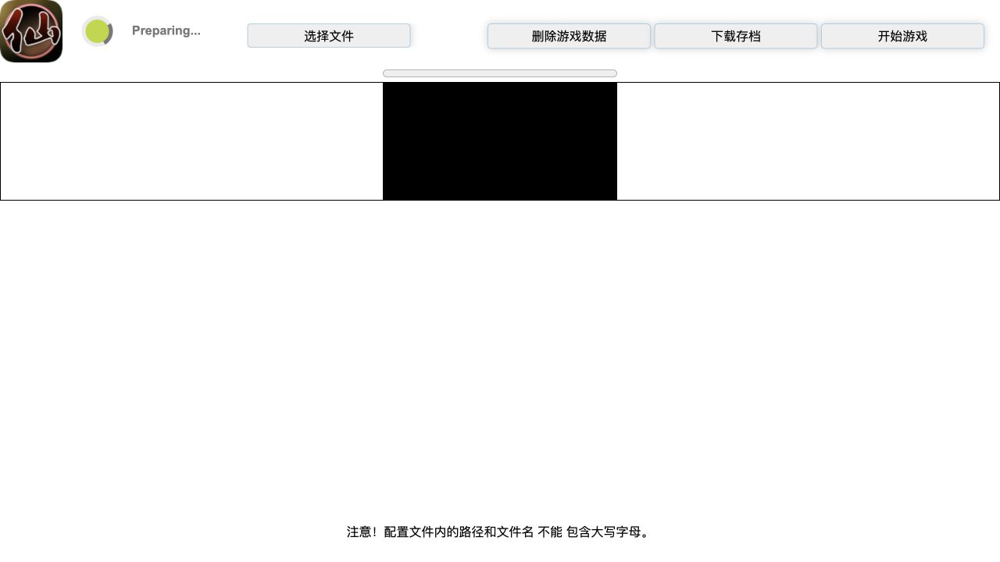</a>

    当前资源导入启动页 <a href="https://sdlpal.github.io/demo/sdlpal.html">图片来源</a>

    经典仙剑奇侠传的跨平台引擎重实现，提供剧情探索、迷宫与回合制战斗。

    **平台：** Windows / macOS / Linux

    **运行：** 按README更新子模块；Linux在unix目录运行make，Windows使用提供的工程，macOS用Xcode；网页版导入原版资源ZIP。

    **所需文件：** 自己的受支持仙剑原版资源；网页版需完整资源ZIP，路径与文件名注意小写。

    [**构建说明**](https://github.com/sdlpal/sdlpal/blob/master/README.md) · [项目介绍](https://github.com/sdlpal/sdlpal) · [在线入口 · 查看文件要求](https://sdlpal.github.io/demo/sdlpal.html)

85. **运输帝国 · OpenLoco**

    

    作者README提供的游戏预览 <a href="https://github.com/OpenLoco/OpenLoco/blob/master/README.md">图片来源</a>

    Locomotion的引擎重实现，铺设交通线路，经营铁路、公路和其他运输网络。

    **平台：** Windows / macOS / Linux

    **运行：** 安装README列出的库，Linux/macOS使用posix预设配置和编译，Windows使用windows预设。

    **所需文件：** 自己的Chris Sawyer’s Locomotion原版资源。

    [**构建说明**](https://github.com/OpenLoco/OpenLoco/blob/master/README.md) · [项目介绍](https://github.com/OpenLoco/OpenLoco)

86. **塞尔达传说：旷野之息 · Savage Wind**

    

    上游问题报告中的移植画面 <a href="https://github.com/Revivedx/SavageWindRecomp/issues/203">图片来源</a>

    在海拉鲁探索、攀爬并解开神庙谜题。此实验移植目前以开场和初始台地为已报告范围。

    **平台：** Windows 10+ / Linux x86-64，Vulkan1.3

    **运行：** 解压Windows包或运行Linux AppImage，选择自有1.9.0的ExeFS和RomFS目录，完成本机构建后启动。源码构建需Clang、SDL3、FFmpeg和Vulkan工具，按README执行make gen与make。

    **所需文件：** 自己的Switch版1.9.0游戏与合并更新的exefs/romfs；CPU需SSE4.2，约35GB空间，DLC尚不支持。

    [**构建说明**](https://github.com/Revivedx/SavageWindRecomp/blob/main/README.md) · [项目源码](https://github.com/Revivedx/SavageWindRecomp)

87. **超级马力欧64 · sm64coopdx**

    

    上游项目预览 <a href="https://i.ytimg.com/vi/hmqbLyszoYY/maxresdefault.jpg">图片来源</a>

    在同步的关卡中与朋友一起冒险，支持 Lua 模组和扩展玩法。

    **平台：** Windows / macOS / Linux

    **运行：** 按仓库Makefile配置编译器与图形依赖，准备受支持的原版数据后用make构建，再运行生成的客户端。

    **所需文件：** 按项目安装/构建说明准备受支持的原版游戏文件。

    [**构建说明**](https://github.com/coop-deluxe/sm64coopdx/blob/main/Makefile) · [项目源码](https://github.com/coop-deluxe/sm64coopdx)

88. **洞窟物语 · doukutsu-rs**

    

    作者提供的免费版画面 <a href="https://github.com/doukutsu-rs/doukutsu-rs/blob/master/README.md">图片来源</a>

    用Rust重实现洞窟物语，进行平台跳跃、射击与探索，支持原免费版及受支持的Cave Story+数据。

    **平台：** Windows / macOS / Linux

    **运行：** 按上游CI列出的系统依赖准备Rust，cargo build --release --locked --bin doukutsu-rs；与受支持原版数据配合运行。

    **所需文件：** 自己的受支持免费版或Cave Story+数据；原免费版首次提取还需Doukutsu.exe。

    [**构建说明**](https://github.com/doukutsu-rs/doukutsu-rs/blob/master/.github/workflows/ci.yml) · [项目介绍](https://github.com/doukutsu-rs/doukutsu-rs)

89. **卡马戈登 · Dethrace**

    

    上游项目预览 <a href="https://i.ytimg.com/vi/MMI45O0RKq0/maxresdefault.jpg">图片来源</a>

    逐函数重建经典赛车游戏，让原作在现代系统上原生运行。

    **平台：** Windows / macOS / Linux

    **运行：** 按README的Building章节安装依赖并用CMake构建，将原版或受支持演示版数据放入指定目录后运行。

    **所需文件：** 自己的 Carmageddon 数据，或项目说明支持的演示版数据。

    [**构建说明**](https://github.com/dethrace-labs/dethrace/blob/main/README.md) · [项目源码](https://github.com/dethrace-labs/dethrace)

90. **我的世界 Java版 · Horizon**

    

    上游引擎夕阳场景截图 <a href="https://github.com/ludovic111/horizon">图片来源</a>

    探索方块世界、采集资源与建造家园。使用自有Java版数据运行的Rust引擎重实现。

    **平台：** Windows / Linux / macOS（Apple Silicon）

    **运行：** 可用上游启动器准备资源后启动；自行构建需Rust1.90+、Python3.10+和JDK25，先运行horizon-prepare，再运行horizon-client。

    **所需文件：** 自己的Minecraft Java 26.3安装（先运行一次）与对应server.jar；暂不支持微软账号认证。

    [**构建说明**](https://github.com/ludovic111/horizon/blob/main/README.md) · [项目源码](https://github.com/ludovic111/horizon)

91. **阿克斯之城 · Arx Libertatis**

    <a href="https://github.com/arx/ArxLibertatis/blob/master/README.md">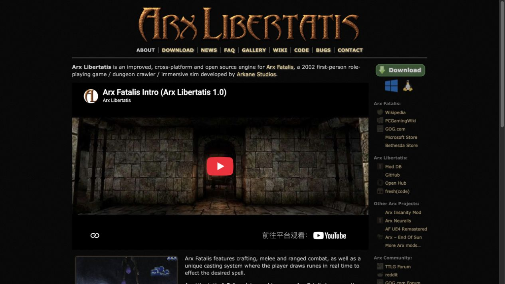</a>

    项目官网与游戏画面预览 <a href="https://arx-libertatis.org/">图片来源</a>

    基于公开源码维护的现代引擎，进行地下城探索、物品制作和符文施法。

    **平台：** Windows / macOS / Linux

    **运行：** 按README准备CMake及SDL、OpenAL等依赖，在build目录配置并make，运行arx并指向原版或演示数据。

    **所需文件：** 自己的Arx Fatalis原版或演示数据。

    [**构建说明**](https://github.com/arx/ArxLibertatis/blob/master/README.md) · [项目介绍](https://github.com/arx/ArxLibertatis)

92. **乐高小岛 · isle-portable**

    <a href="https://github.com/isledecomp/isle-portable/blob/master/README.md">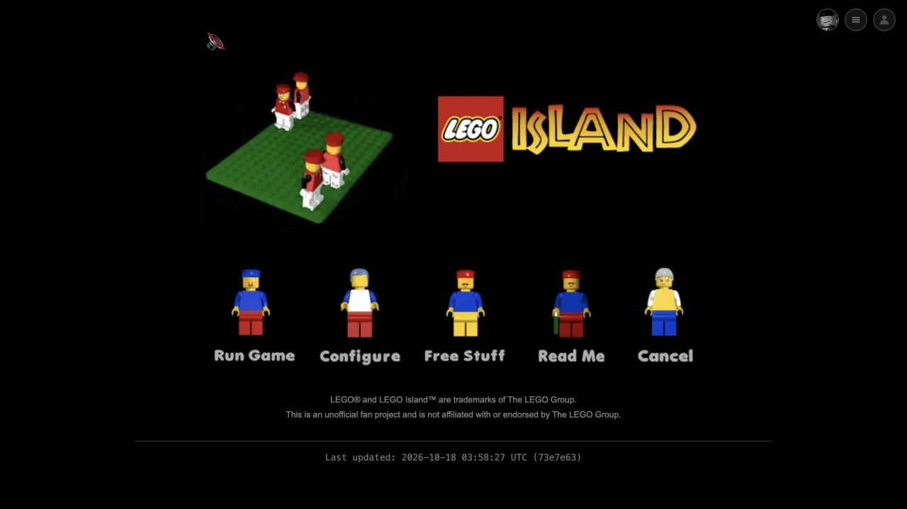</a>

    网页启动器 <a href="https://isle.pizza/">图片来源</a>

    基于已有反编译成果的跨平台移植，保留乐高小岛的探索体验。

    **平台：** Windows / macOS / Linux / 浏览器（构建目标依指南）

    **运行：** 按README的Building章节和项目CI配置选择CMake构建目标，准备LEGO Island英文1.1版数据后运行。

    **所需文件：** 自己的英文1.1版 LEGO Island 游戏数据。

    [**构建说明**](https://github.com/isledecomp/isle-portable/blob/master/README.md) · [项目源码](https://github.com/isledecomp/isle-portable) · [在线入口 · 查看文件要求](https://isle.pizza/)

93. **索尼克狂欢 · Sonic Mania Decompilation**

    

    上游项目预览 <a href="https://i.ytimg.com/vi/CSPhyjHt79Y/maxresdefault.jpg">图片来源</a>

    重建游戏逻辑，支持模组加载及多版本构建。

    **平台：** Windows / Linux

    **运行：** 递归克隆源码及子模块，按How to Build安装依赖并用CMake编译，再放入对应Sonic Mania游戏资源。

    **所需文件：** 自己的受支持 Sonic Mania / Plus 资源；不支持Netflix版。

    [**构建说明**](https://github.com/RSDKModding/Sonic-Mania-Decompilation/blob/master/README.md) · [项目源码](https://github.com/RSDKModding/Sonic-Mania-Decompilation)

94. **寂静岭1 · PsyCross移植**

    <a href="https://github.com/SlickAmogus/silent-hill-decomp/blob/pc-port/README.md">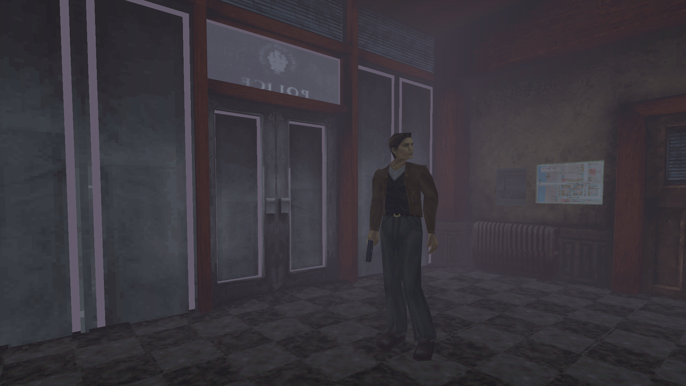</a>

    作者官网提供的移植截图 <a href="https://sh1pc.com/">图片来源</a>

    在雾中的小镇寻找失踪的女儿。基于PS1反编译成果的社区移植，也提供自备光盘镜像的网页版。

    **平台：** Windows / 桌面浏览器；Linux与macOS版本见上游说明

    **运行：** 可下载发布包并选择自己的BIN，或在网页导入。自行构建使用MSYS2/MinGW64、CMake/Ninja、SDL2、OpenAL，拉取子模块后运行pc_port\build.bat。

    **所需文件：** 自己的Silent Hill PS1 BIN镜像；Windows构建说明使用USA SLUS-00707，网页版也接受PAL和NTSC-J。

    [**构建说明**](https://github.com/SlickAmogus/silent-hill-decomp/blob/pc-port/README.md) · [项目源码](https://github.com/SlickAmogus/silent-hill-decomp) · [在线入口 · 查看文件要求](https://sh1pc.com/play/)

95. **马力欧卡丁车Wii · KartPad**

    

    上游0.4.23版启动器宣传图 <a href="https://github.com/chrissotraidis/kartpad">图片来源</a>

    驾驶卡丁车争夺名次，并可加入Retro Rewind内容。基于WiiCompiled，面向手机、平板和Apple Silicon Mac。

    **平台：** Android ARM64 / iPhone / iPad / macOS 14+（Apple Silicon）

    **运行：** Android安装上游APK后导入游戏目录；Apple设备可用PadMint在自己的Mac上构建并安装。手动Apple构建使用Xcode、CMake/Ninja、Python3、.NET8和Rust，按指南运行self-build-macos.sh。

    **所需文件：** 自己的PAL RMCP01 Rev0游戏提取DATA目录；直接导入ISO/WBFS另需自有Wii common-key.bin，Android也接受RVZ。

    [**构建说明**](https://github.com/chrissotraidis/kartpad/blob/main/docs/BUILDING.md) · [项目源码](https://github.com/chrissotraidis/kartpad)

96. **任天堂明星大乱斗 特别版 · OpenSmash**

    

    上游项目标题图 <a href="https://github.com/OpenSmash-Ultimate/ssbu-recomp">图片来源</a>

    让不同系列的角色在平台擂台上混战。将自有Switch游戏静态重编译为Windows程序的社区项目。

    **平台：** Windows 10 / 11，64位，Vulkan显卡

    **运行：** 下载源码ZIP或克隆仓库，运行Install SSBU.bat，确认自有文件后在本机构建，再运行Play SSBU.bat；安装器会准备所需工具与运行库。

    **所需文件：** 自己的Switch游戏13.0.4或13.0.5数据及对应prod.keys；按上游说明准备更新与DLC。

    [**构建说明**](https://github.com/OpenSmash-Ultimate/ssbu-recomp/blob/main/BUILDING.md) · [项目源码](https://github.com/OpenSmash-Ultimate/ssbu-recomp)

97. **毁灭战士3 · D3Wasm**

    

    作者提供的D3Wasm游戏截图 <a href="https://www.continuation-labs.com/projects/d3wasm/">图片来源</a>

    基于Doom 3公开引擎源码的WebAssembly移植，在火星基地进行第一人称探索与战斗；作者在线演示使用Demo内容。

    **平台：** Linux / Windows WSL构建；支持WASM和WebGL的桌面浏览器运行

    **运行：** 按BUILD.md配置Emscripten和CMake，编译neo目录，将Demo数据打包后启动本地HTTP服务，打开d3wasm.html。作者网站另提供在线演示说明，首次约400MB。

    **所需文件：** 自行构建需Doom 3 Demo的demo00.pk4；运行完整版需自己的对应游戏资源。

    [**构建说明**](https://github.com/gabrielcuvillier/d3wasm/blob/master/BUILD.md) · [项目源码](https://github.com/gabrielcuvillier/d3wasm) · [资源获取](https://www.fileplanet.com/archive/p-15998/DOOM-3-Demo)

98. **007：黄金眼 · Project Midas**

    

    上游项目标题图 <a href="https://github.com/murkantor/Project-Midas">图片来源</a>

    重访黄金眼的潜入射击任务。基于N64既有源码重建的Windows和Linux移植，部分扩展功能仍在开发。

    **平台：** Windows / Linux

    **运行：** 按Docker构建说明提取自有镜像并生成程序；将美版镜像放入Data目录后运行ProjectMidas。Windows构建步骤使用WSL。

    **所需文件：** 自己的美版GoldenEye N64卡带镜像；Linux运行还需32位SDL2和OpenGL。

    [**构建说明**](https://github.com/murkantor/Project-Midas/blob/main/README.md) · [项目源码](https://github.com/murkantor/Project-Midas)

99. **极限竞速：地平线1 · ReImagined**

    

    上游项目提供的游戏画面 <a href="https://github.com/FH1-ReImagined/ForzaHorizon1-ReImagined/blob/main/docs/images/forza-race.jpg">图片来源</a>

    参加科罗拉多汽车音乐节，在开放道路与赛道上驾驶竞速。基于Xbox360版本的社区重编译。

    **平台：** Windows 10 / 11 x64 / Linux x86-64 / Steam Deck

    **运行：** 安装上游启动器；Linux可用Flatpak或tar.gz。选择自己的光盘镜像、Games on Demand包或解包目录，点击Build，再Play；Steam Deck按上游指南配置。

    **所需文件：** 自己的Xbox360 Forza Horizon文件；TU4和DLC按需自备，约15GB空间。

    [**构建说明**](https://github.com/FH1-ReImagined/ForzaHorizon1-ReImagined/blob/main/README.md) · [项目源码](https://github.com/FH1-ReImagined/ForzaHorizon1-ReImagined)

100. **007：黄金眼 · jkdansereau移植**

     

     上游分屏游戏截图 <a href="https://github.com/jkdansereau/goldeneye-pc-port">图片来源</a>

     重访007的潜入射击战役与分屏对战。基于既有N64源码重建，提供Windows与Linux原生程序。

     **平台：** Windows / Linux / Steam Deck

     **运行：** 解压发布包，将美版ROM命名为ge007.ntsc-final.z64放入data目录后启动。源码构建需CMake、SDL2、zlib、Python3及MIPS工具，提取数据后执行build-pc.sh ntsc-final。

     **所需文件：** 自己的NTSC-U美版GoldenEye 007 ROM；显卡需OpenGL3.0。

     [**构建说明**](https://github.com/jkdansereau/goldeneye-pc-port/blob/main/docs/building.md) · [项目源码](https://github.com/jkdansereau/goldeneye-pc-port)

101. **真人快打：少林武僧 · OpenShao**

     

     上游问题报告中的游戏画面 <a href="https://github.com/OAleex/OpenShao/issues/2">图片来源</a>

     在真人快打世界探索并进行动作战斗，支持本地双人合作。Xbox版本的Windows/Linux重编译。

     **平台：** Windows 10 1903+ / Linux x64（glibc2.38+）

     **运行：** 解压发布包，打开OpenShao，选择自有ISO、XISO、ZIP或解包目录后Play。自行构建需Python3.11、Git及VS2022/LLVM21或Clang18，按构建指南运行build_recomp.py。

     **所需文件：** 自己的USA/Europe Xbox游戏数据及default.xbe；SSE4.2/POPCNT CPU，D3D12或Vulkan1.2显卡。

     [**构建说明**](https://github.com/OAleex/OpenShao/blob/main/README.md) · [项目源码](https://github.com/OAleex/OpenShao)

102. **古惑狼赛车 · High Octane**

     

     作者提供的项目画面 <a href="https://github.com/Rinnegatamante/Crash-Team-Racing-High-Octane/blob/vita/README.md">图片来源</a>

     基于CTR重建成果的移植，包含赛车、道具和计时模式，并提供WASM入口。

     **平台：** Windows / Linux / macOS构建；浏览器运行

     **运行：** 按上游部署工作流准备Emscripten 6.0.9、CMake和Ninja，用emcmake配置build-web后编译；浏览器需导入自己的光盘。

     **所需文件：** 自己的受支持CTR美版PS1光盘BIN；联机另有密钥文件输入。

     [**构建说明**](https://github.com/Rinnegatamante/Crash-Team-Racing-High-Octane/blob/vita/.github/workflows/deploy-pages.yml) · [项目介绍](https://github.com/Rinnegatamante/Crash-Team-Racing-High-Octane) · [在线入口 · 查看文件要求](https://rinnegatamante.github.io/Crash-Team-Racing-High-Octane)

103. **疯狂都市 · Open1560**

     

     上游城市驾驶预览 <a href="https://github.com/0x1F9F1/Open1560">图片来源</a>

     在城市道路中驾驶与竞速。针对Midtown Madness预览版Build1560的部分重实现，保留尚未重写的汇编代码。

     **平台：** Windows

     **运行：** 将上游发布包解压到游戏目录并运行Open1560.exe。自行构建需VS2022 C++，用premake5指定原版安装路径生成解决方案后编译。

     **所需文件：** 自己的Midtown Madness数据audio.ar、core.ar和ui.ar。

     [**构建说明**](https://github.com/0x1F9F1/Open1560/blob/master/docs/building.md) · [项目源码](https://github.com/0x1F9F1/Open1560)

104. **塞尔达传说II：林克的冒险 · z2rs**

     <a href="https://github.com/troyedwardsjr/z2rs/blob/main/README.md">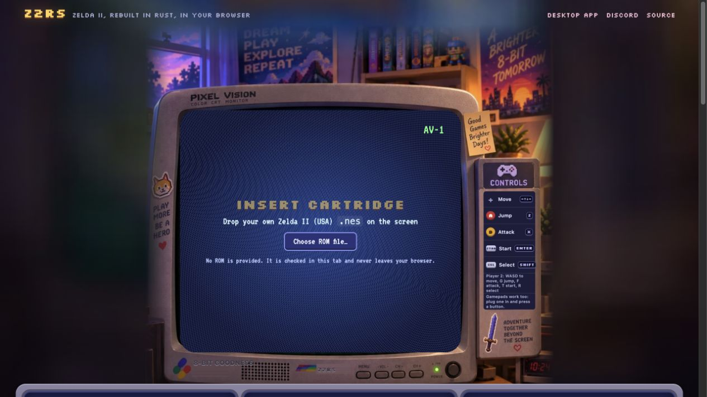</a>

     ROM导入页 <a href="https://z2rs.com/">图片来源</a>

     用 Rust 重建横版战斗与地图探索，并提供浏览器版本和可选双人模式。

     **平台：** 桌面 / 浏览器 / Android（源码构建）

     **运行：** 安装Rust stable；桌面用make build、make run，网页另需wasm-pack并用make run-web；运行前设置Z2_ROM指向自己的ROM。

     **所需文件：** 自己的受支持美版 Zelda II .nes ROM，由页面校验。

     [**构建说明**](https://github.com/troyedwardsjr/z2rs/blob/main/README.md) · [项目源码](https://github.com/troyedwardsjr/z2rs) · [在线入口 · 查看文件要求](https://z2rs.com/)

105. **迪迪金刚赛车 · Golden Balloon**

     

     当前ROM导入页 <a href="https://akratch.github.io/golden-balloon/">图片来源</a>

     基于游戏反编译成果的原生与WebGPU移植，提供卡丁车竞速和本地多人模式。

     **平台：** Windows / macOS / Linux

     **运行：** 准备CMake、C11工具链和SDL2，用cmake配置编译；网页版按README使用固定版本emsdk与tools/web/build_web.sh。

     **所需文件：** 自己的美版或欧版1.1 ROM（.z64 / .v64 / .n64）；网页版需WebGPU浏览器。

     [**构建说明**](https://github.com/akratch/goldenballoon/blob/main/README.md) · [项目介绍](https://github.com/akratch/goldenballoon) · [在线入口 · 查看文件要求](https://akratch.github.io/golden-balloon/)

106. **沙丘2 · Dune Dynasty**

     

     上游战斗与菜单截图拼图 <a href="https://github.com/gameflorist/dunedynasty">图片来源</a>

     在厄拉科斯采集香料、建设基地并指挥部队。基于OpenDUNE逆向引擎的现代增强移植。

     **平台：** Windows / macOS / Linux

     **运行：** 下载对应平台发布包，把PAK文件放入上游说明的数据目录后启动。自行构建需CMake、Allegro等依赖，执行对应平台build脚本。

     **所需文件：** 自己的Dune II欧洲版v1.07 PAK数据，文件清单见上游FILELIST.TXT。

     [**构建说明**](https://github.com/gameflorist/dunedynasty/blob/master/README.md) · [项目源码](https://github.com/gameflorist/dunedynasty)

107. **铁拳TT2 · Shihab PC移植**

     

     上游对战截图 <a href="https://github.com/shihabal3amri/tekken-tag-tournament-2-pc">图片来源</a>

     双人组队的3D格斗，切换角色进行连招。将Xbox360原作静态重编译为Windows程序的社区项目。

     **平台：** Windows 10 / 11，64位，DirectX11

     **运行：** 运行上游ttt2_setup.exe并选择自有ISO和TU3，由安装器在本地构建后启动。源码构建需VS2022、Clang、CMake/Ninja、Python3.10+及XenonRecomp。

     **所需文件：** 自己的Xbox360美/欧版ISO与Title Update3、约13GB空间；在线功能还需Steam。

     [**构建说明**](https://github.com/shihabal3amri/tekken-tag-tournament-2-pc/blob/main/BUILDING.md) · [项目源码](https://github.com/shihabal3amri/tekken-tag-tournament-2-pc)

108. **跑车浪漫旅2 · GT2 PC / Browser**

     

     作者提供的项目画面 <a href="https://github.com/dubrovskiy-yevhen-stakelogic/gt-2-pc/blob/main/README.md">图片来源</a>

     将Gran Turismo 2移植到桌面与浏览器，提供Arcade和Simulation赛车模式。

     **平台：** Windows / macOS / Linux

     **运行：** 按README使用对应平台构建脚本；浏览器构建见docs/WEB.md，运行时选择自己的完整BIN镜像。

     **所需文件：** 自己的完整2352字节/扇区BIN镜像；网页版不支持VR或联机。

     [**构建说明**](https://github.com/dubrovskiy-yevhen-stakelogic/gt-2-pc/blob/main/README.md) · [项目介绍](https://github.com/dubrovskiy-yevhen-stakelogic/gt-2-pc) · [在线入口 · 查看文件要求](https://ydubr-gt2.surge.sh)

109. **反重力赛车：欧米伽合集 · PC移植**

     

     上游问题报告中的PS4模式画面对比 <a href="https://github.com/AbdelmoumenDeghbouche/wipeout_pc/issues/55">图片来源</a>

     驾驶反重力飞船高速竞赛，包含2048、HD和Fury内容。PS4程序通过社区运行时在PC执行。

     **平台：** Windows 10 / 11 x64，AVX，Vulkan1.3

     **运行：** 解压wipeout-windows.zip，运行WipEout.exe，选择包含eboot.bin的自有游戏目录后PLAY。自行构建使用MSYS2 CLANG64、Python3.10及子模块，按README运行build.sh。

     **所需文件：** 自己的PS4 WipEout Omega Collection及对应更新，合并为含eboot.bin的目录。

     [**构建说明**](https://github.com/AbdelmoumenDeghbouche/wipeout_pc/blob/main/README.md) · [项目源码](https://github.com/AbdelmoumenDeghbouche/wipeout_pc)

110. **帝国时代 / 罗马复兴 · 基础玩法重实现**

     

     上游README中的基础地图画面 <a href="https://github.com/FolkertVanVerseveld/aoe/blob/master/README.md">图片来源</a>

     采集资源、建设聚落并指挥单位。当前主要是基础多人玩法，电脑对手行为仍有限。

     **平台：** Windows / Linux；macOS见上游源码说明

     **运行：** 安装C/C++、CMake、SDL2及image/mixer依赖，运行cmake -S . -B build后编译empires。挂载自己的CD或准备安装目录；Linux字体路径需按INSTALL调整。

     **所需文件：** 自己的Age of Empires或Rise of Rome原版数据、language.dll与字体。

     [**构建说明**](https://github.com/FolkertVanVerseveld/aoe/blob/master/README.md) · [项目源码](https://github.com/FolkertVanVerseveld/aoe)

111. **东方永夜抄 TH08**

     

     上游标题预览 <a href="https://github.com/N0zoM1z0/th08-web">图片来源</a>

     在密集弹幕中移动与射击，体验东方永夜抄的夜间冒险。浏览器版本来自已有源码重建项目。

     **平台：** Windows 32-bit / Linux

     **运行：** 准备原版TH08数据与指南要求的工具链，按构建说明选择原版重建或Linux移植目标。

     **所需文件：** 自己的TH08 1.00d原程序和数据；运行时需th08.dat、thbgm.dat，工具链按构建目标准备。

     [**构建说明**](https://github.com/N0zoM1z0/th08/blob/main/docs/BUILD_MATCHING.md) · [项目源码](https://github.com/N0zoM1z0/th08) · [在线入口 · 查看文件要求](https://th08-web.pages.dev/)

112. **任天堂明星大乱斗X · Brawl Recompiled**

     

     上游项目提供的游戏画面 <a href="https://github.com/josiahg2502-glitch/BrawlRecompiled/blob/master/screenshots/05_castle_siege.jpg">图片来源</a>

     选择任天堂角色进行平台格斗。目前上游报告覆盖对战、菜单及亚空使者开头。

     **平台：** Windows / Linux x86-64

     **运行：** 下载对应平台包，用启动器选择自己的Wii光盘镜像。源码构建需Windows、Python3、16GB内存及README指定的WiiCompiled工具链，提取游戏后运行build_modules.py和build-brawl.ps1。

     **所需文件：** 自己的USA RSBE01 Wii ISO、CISO或WBFS；模组需另备对应文件。

     [**构建说明**](https://github.com/josiahg2502-glitch/BrawlRecompiled/blob/master/README.md) · [项目源码](https://github.com/josiahg2502-glitch/BrawlRecompiled)

113. **光环：战斗进化 · Chupathingy**

     

     上游多人大厅截图 <a href="https://github.com/ChupathingyCE/chupathingyce">图片来源</a>

     体验光环初代的战役和多人对战。这一社区移植基于已有反编译成果，支持桌面与Android。

     **平台：** Windows / macOS / Linux（含Steam Deck）/ Android

     **运行：** 准备Python3、clang和ninja，运行configure.py并构建对应平台目标；启动后选择自己的Halo数据。也可使用上游发布包。

     **所需文件：** 自己的Halo Xbox、PC或Custom Edition地图及对应数据。

     [**构建说明**](https://github.com/ChupathingyCE/chupathingyce/blob/main/README.md) · [项目源码](https://github.com/ChupathingyCE/chupathingyce)

114. **DX-Ball 1.07**

     

     上游标题画面 <a href="https://github.com/N0zoM1z0/dx-ball">图片来源</a>

     移动挡板接住弹球，清除屏幕上的砖块。这个经典 Windows 游戏正在通过 REA 调查重建为 C/C++。

     **平台：** Windows 32-bit / Wine

     **运行：** 按构建指南准备Python、VC4工具链及原版1.07文件，构建Windows程序；Linux构建环境另需32位Wine。

     **所需文件：** 自己的匹配版本原程序和资源，并按源码指南构建。

     [**构建说明**](https://github.com/N0zoM1z0/dx-ball/blob/main/docs/BUILD.md) · [项目源码](https://github.com/N0zoM1z0/dx-ball)

115. **王国之心：记忆之链 · ReKHCoM**

     

     作者提供的项目画面 <a href="https://github.com/MatyMeatBoy/ReKHCoM/blob/main/README.md">图片来源</a>

     将GBA游戏重建成果移植到桌面和浏览器，结合动作战斗与卡牌组合。

     **平台：** Windows构建；另有Linux、Android和浏览器版本

     **运行：** 按README准备Python/PyYAML、llvm-mingw、SDL3和Ninja，用configure_pc.py生成后由Ninja构建。

     **所需文件：** 自己的未修改美、日或欧版GBA ROM；语言随ROM版本。

     [**构建说明**](https://github.com/MatyMeatBoy/ReKHCoM/blob/main/README.md) · [项目介绍](https://github.com/MatyMeatBoy/ReKHCoM) · [在线入口 · 查看文件要求](https://matymeatboy.github.io/ReKHCoM/)

116. **特技赛车 · Stunts HD**

     

     项目标题预览 <a href="https://github.com/mr-finster/stunts-hd/blob/main/README.md">图片来源</a>

     DOS赛车的静态重编译项目，提供宽屏、高清3D与浏览器入口。

     **平台：** Windows / macOS / Linux

     **运行：** 按README准备Restunts和原版GAME.EXE，生成exedump/map.json，再运行Python服务打开本地stunts页面。

     **所需文件：** 自己的Stunts 1.1游戏目录或ZIP及构建所需原程序。

     [**构建说明**](https://github.com/mr-finster/stunts-hd/blob/main/README.md) · [项目介绍](https://github.com/mr-finster/stunts-hd) · [在线入口 · 查看文件要求](https://stunts-recomp.pages.dev)

117. **东方文花帖 TH095**

     

     上游标题画面 <a href="https://github.com/N0zoM1z0/th095">图片来源</a>

     躲避弹幕并寻找拍摄时机。项目重建原版 Windows 程序，作者已公开运行录像与测试说明。

     **平台：** Windows 32-bit

     **运行：** 准备TH095 1.02a文件与VC7.1工具链，按指南执行整程序编译和链接，再运行生成的EXE。

     **所需文件：** 自己的 TH095 1.02a 程序和游戏数据，按原项目构建。

     [**构建说明**](https://github.com/N0zoM1z0/th095/blob/main/docs/BUILD_MATCHING.md) · [项目源码](https://github.com/N0zoM1z0/th095)

118. **命令与征服：将军绝命时刻 · NewShoes**

     <a href="https://github.com/Agusx1211/NewShoes/blob/main/README.md">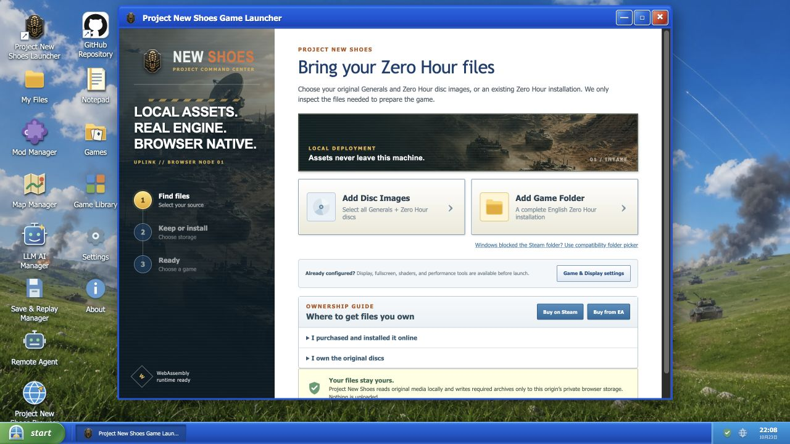</a>

     当前游戏文件导入启动器 <a href="https://newshoes.gg">图片来源</a>

     基于公开C++引擎源码的WASM移植，提供基地建设、战役和遭遇战。

     **平台：** 桌面浏览器

     **运行：** 准备README指定的Emscripten 3.1.6、Node.js、npm与CMake，安装依赖并执行build:port:threaded:release，再启动harness服务。

     **所需文件：** 自己的完整英文Zero Hour安装目录，或将军与绝命时刻光盘。

     [**构建说明**](https://github.com/Agusx1211/NewShoes/blob/main/README.md) · [项目介绍](https://github.com/Agusx1211/NewShoes) · [在线入口 · 查看文件要求](https://newshoes.gg)

119. **乐雅传说 · Legend of Legaia**

     

     作者提供的项目画面 <a href="https://github.com/AndrewAltimit/legend-of-legaia-re/blob/main/README.md">图片来源</a>

     从逆向记录重实现的Rust引擎，探索城镇与世界地图，进行回合制战斗和组合技。

     **平台：** Windows / macOS / Linux

     **运行：** 按README准备支持2024 edition的Rust工具链，cargo build --release，运行引擎并指定自己的光盘数据。

     **所需文件：** 自己的受支持美版Legend of Legaia SCUS-94254光盘BIN。

     [**构建说明**](https://github.com/AndrewAltimit/legend-of-legaia-re/blob/main/README.md) · [项目介绍](https://github.com/AndrewAltimit/legend-of-legaia-re) · [在线入口 · 查看文件要求](https://andrewaltimit.github.io/legend-of-legaia-re/play.html)

120. **世嘉索尼克刺猬 · 原生移植**

     

     上游项目提供的游戏画面 <a href="https://github.com/cheviman/segasonic-port/blob/main/docs/screenshots/volcanic_vault.png">图片来源</a>

     与索尼克、雷和迈迪一起逃出机关岛，可三人同屏合作。提供街机与家用风格两种模式。

     **平台：** Windows / Linux / macOS；Android、Switch及Anbernic H700需自己生成资源包

     **运行：** 解压对应平台包，将自己的sonic.zip放在程序旁，或拖入首次启动窗口。源码构建需CMake3.20、C11/C++17、Python3.10和SDL2，按README配置编译。

     **所需文件：** 自己的MAME sonic.zip（Japan rev.C，18个文件）；首次启动提取本地资源包。

     [**构建说明**](https://github.com/cheviman/segasonic-port/blob/main/README.md) · [项目源码](https://github.com/cheviman/segasonic-port)

121. **镜之边缘 iPad版 · Glassline**

     

     上游屋顶跳跃截图 <a href="https://github.com/MoonCellar-Team/Glassline">图片来源</a>

     在城市楼顶奔跑、跳跃与滑行。这是2010年iPad横向跑酷作品的桌面和Android移植。

     **平台：** Windows 10 / 11 x64 / Linux / Steam Deck / Android 9+

     **运行：** 下载对应平台发布包，启动Glassline并选择自有IPA或解包APP后Play。源码构建在Linux使用build.sh，Windows交叉构建需Clang、CMake和Python3，Android按脚本准备SDK/NDK。

     **所需文件：** 自己的iPad Mirror’s Edge 1.1.48或更新版IPA；PC也接受解包APP目录。

     [**构建说明**](https://github.com/MoonCellar-Team/Glassline/blob/main/README.md) · [项目源码](https://github.com/MoonCellar-Team/Glassline)

122. **摇滚乐队3 · slopband3**

     

     上游项目提供的游戏画面 <a href="https://github.com/idio-sync/band3_recomp/blob/main/docs/images/gameplay.jpg">图片来源</a>

     跟随音符演奏吉他、鼓、键盘和人声，可多人组乐队。基于Xbox360版本的社区重编译。

     **平台：** Windows / Linux / Steam Deck

     **运行：** 按README准备指定ReXGlue SDK，将自有default.xex和gen文件夹放入assets，运行codegen及CMake构建，再启动band3。Linux步骤见上游Building文档。

     **所需文件：** 自己的Rock Band 3 TU5或兼容Deluxe数据，包含main/patch ARK；乐器支持按上游清单。

     [**构建说明**](https://github.com/idio-sync/band3_recomp/blob/main/README.md) · [项目源码](https://github.com/idio-sync/band3_recomp)

123. **杰克与达斯特三部曲 · Precursor**

     

     上游游戏启动器截图 <a href="https://github.com/thebardockgames/Precursor">图片来源</a>

     在Android上探索杰克与达斯特的平台跳跃冒险。基于OpenGOAL的实验移植，三部作品仍在开发。

     **平台：** Android 9及以上 / ARM64

     **运行：** 按上游说明准备Android SDK、NDK并构建APK；也可下载beta APK，导入自己的PS2光盘镜像后由应用提取和编译。

     **所需文件：** 自己的对应PS2游戏ISO；设备需支持OpenGL ES 3.2。

     [**构建说明**](https://github.com/thebardockgames/Precursor/blob/master/README.md) · [项目源码](https://github.com/thebardockgames/Precursor)

124. **格兰蒂亚3 · PC重编译**

     

     原帖提供的游戏预览 <a href="https://x.com/McGroin83/status/2114706219973677067">图片来源</a>

     跟随尤奇冒险，并在回合制战斗中使用连击和取消技。PS2作品的Windows重编译。

     **平台：** Windows 10 / 11，Direct3D11.3；Linux / Steam Deck通过Proton

     **运行：** 解压发布包，运行Grandia3.exe并选择自己的Disc1镜像，Disc2按需切换。自行构建需LLVM-MinGW、Ninja和Python，按README提取Disc1、生成代码后运行build.py。

     **所需文件：** 自己的Grandia III USA Disc1与Disc2 ISO。

     [**构建说明**](https://github.com/GranasSabre/Grandia3-PC/blob/main/README.md) · [项目源码](https://github.com/GranasSabre/Grandia3-PC)

125. **横扫千军：王国 · OpenKingdoms**

     

     作者提供的项目画面 <a href="https://github.com/OpenKingdoms/OpenKingdoms/blob/main/README.md">图片来源</a>

     以C语言重实现幻想即时战略引擎，发展经济、建造军队并指挥魔法战斗。

     **平台：** Windows / macOS / Linux

     **运行：** 按README准备CMake和SDL2，设置TAK_GAME_DIR后配置、编译并运行tak-re；另有浏览器导入入口。

     **所需文件：** 自己的Total Annihilation: Kingdoms游戏目录或资源包；扩展需对应数据。

     [**构建说明**](https://github.com/OpenKingdoms/OpenKingdoms/blob/main/README.md) · [项目介绍](https://github.com/OpenKingdoms/OpenKingdoms) · [在线入口 · 查看文件要求](https://openkingdoms.net)

126. **皇牌空战04 · ProjectStonehenge**

     

     上游空战截图 <a href="https://github.com/Onaga00/ProjectStonehenge">图片来源</a>

     驾驶战斗机完成空战与对地任务。把PS2美版逐函数重建为Windows原生程序的社区项目。

     **平台：** Windows 10 / 11，64位，Vulkan1.2

     **运行：** 解压上游发布包，运行ProjectStonehenge.exe并选择自己的ISO。自行构建需VS2026 C++与CMake3.24+，执行cmake --preset windows及cmake --build --preset release。

     **所需文件：** 自己的NTSC-U美版SLUS-20152 ISO（2048字节扇区），不接受原始BIN/CUE。

     [**构建说明**](https://github.com/Onaga00/ProjectStonehenge/blob/main/README.md) · [项目源码](https://github.com/Onaga00/ProjectStonehenge)

127. **文明2多人黄金版 · OpenCiv2**

     

     上游城市管理画面截图 <a href="https://github.com/richardpenman/civ2">图片来源</a>

     从一座城市开始，发展科技、外交与军队。把文明2多人黄金版重建为跨平台C++程序。

     **平台：** Windows / Linux x86-64 / macOS 11+（Intel与Apple Silicon）

     **运行：** 下载对应平台程序，首次启动选择自己的安装、CD或CUE/BIN镜像。自行构建需C/C++、SDL2、Python3和pefile，按README运行tools/build_port.py。

     **所需文件：** 自己的Civilization II Multiplayer Gold Edition安装、CD或CUE/BIN镜像；音乐来自CD音轨。

     [**构建说明**](https://github.com/richardpenman/civ2/blob/main/README.md) · [项目源码](https://github.com/richardpenman/civ2)

128. **秘密潜入 · IGI-RE**

     

     上游README提供的游戏预览 <a href="https://github.com/slickdaddyy/IGI-RE/blob/main/docs/media/igi.jpg">图片来源</a>

     潜入军事设施，完成侦察和射击任务。把2000年原作重建为可编译的C程序。

     **平台：** Windows / Linux（Wine）

     **运行：** 准备CMake、Ninja和i686 MinGW-w64，按README编译igidecomp.exe，将它放入自有游戏目录后运行；Linux用Wine。dinput.dll是可选的对照测试路径。

     **所需文件：** 自己的固定EU版安装，以及ANYS.AFP、MPZM.AFP、YMBE.AFP文件；版本哈希见README。

     [**构建说明**](https://github.com/slickdaddyy/IGI-RE/blob/main/README.md) · [项目源码](https://github.com/slickdaddyy/IGI-RE)

129. **旧金山狂飙2049 · Rush 2049 Recompiled**

     <a href="https://github.com/n64hub/rush-2049-recomp/blob/main/README.md#in-a-browser">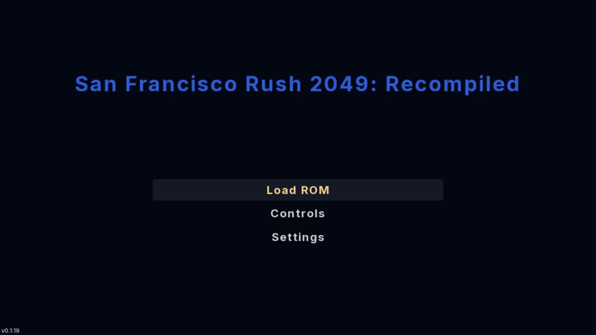</a>

     当前网页ROM启动器，未载入游戏文件 <a href="https://n64hub.com/rush-2049/">图片来源</a>

     在未来都市中竞速、抄近道并完成特技；N64静态重编译项目提供原生和WebGPU版本。

     **平台：** Chrome / Edge 113+（WebGPU）；可按文档在Linux或Windows/WSL构建

     **运行：** 原生版按README提取ROM并用Ninja构建；网页版另准备Emscripten、naga与SPIRV-Tools，通过emcmake构建build-web。也可打开在线入口，在启动器选取自己的ROM。 使用支持WebGPU的Chrome或Edge 113+；首次提示跨源隔离时刷新一次。

     **所需文件：** 自己的美版N64 ROM（.z64），SHA-1为3f99351d7bb61656614bdb2aa1a90cfe55d1922c。

     [**构建说明**](https://github.com/n64hub/rush-2049-recomp/blob/main/README.md#in-a-browser) · [项目源码](https://github.com/n64hub/rush-2049-recomp) · [在线入口 · 查看文件要求](https://n64hub.com/rush-2049/)

130. **马力欧激战前锋 Charged · PS Vita**

     

     上游PS Vita比赛截图 <a href="https://github.com/CBOC-Vita-Lab/strikers-charged-vita">图片来源</a>

     马力欧角色登场的快节奏足球对抗。基于既有反编译成果移植至PS Vita。

     **平台：** 支持自制软件的PS Vita

     **运行：** 可用VitaShell安装上游VPK，将提取的sys与files放入ux0: 下的 data → mscharged → game 目录后启动。源码构建使用Linux、VitaSDK、Clang18及上游固定依赖。

     **所需文件：** 自己的Wii美版Rev1（R4QE01）游戏数据、合法取得的libshacccg.suprx及约3GB空间。

     [**构建说明**](https://github.com/CBOC-Vita-Lab/strikers-charged-vita/blob/main/docs/BUILDING.md) · [项目源码](https://github.com/CBOC-Vita-Lab/strikers-charged-vita)

131. **特技赛车FX · Mabec增强移植**

     

     作者README提供的竞速动图 <a href="https://github.com/Mabec-games/Stunt-Race-FX-DECOMP/blob/main/README.md">图片来源</a>

     驾驶卡通赛车参加Speed Trax竞速。基于SNES反编译移植，增加平滑画面与高分辨率绘制。

     **平台：** Linux（源码构建）

     **运行：** 准备Clang、Python3和SDL3开发库，按README设置自己的ROM路径并运行link.sh，然后用--rom参数启动生成的stuntracefx。

     **所需文件：** 自己的Stunt Race FX USA Rev1 SFC；SHA1为781e376ff453a83c7bcf72339abe6b842efd9c86。

     [**构建说明**](https://github.com/Mabec-games/Stunt-Race-FX-DECOMP/blob/main/README.md) · [项目源码](https://github.com/Mabec-games/Stunt-Race-FX-DECOMP)

132. **Ultima VI：Amiga 版移植**

     <a href="https://github.com/2lab-ai/ultima6/blob/main/README.md">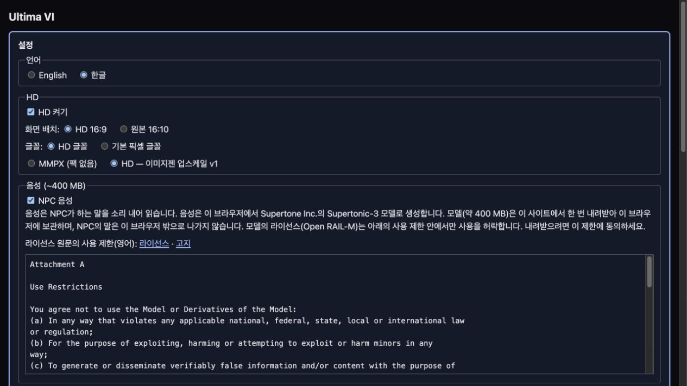</a>

     设置入口 <a href="https://ultima6.2lab.ai/">图片来源</a>

     探索世界、与角色交谈并进行战斗。这个 Rust 项目把 Amiga 版 Ultima VI 带到原生环境和浏览器。

     **平台：** 浏览器（WebAssembly）/ Rust原生窗口版

     **运行：** 安装Rust和Node.js 22+，按Build章节构建原生或网页版，再提供自己的Amiga游戏文件；语音等增强内容可选。

     **所需文件：** 自己的 Amiga 游戏文件；入口另有画面和可选语音设置。

     [**构建说明**](https://github.com/2lab-ai/ultima6/blob/main/README.md) · [项目源码](https://github.com/2lab-ai/ultima6) · [在线入口 · 查看文件要求](https://ultima6.2lab.ai/)

133. **GunZ：The Duel · GunZRs**

     

     作者提供的项目画面 <a href="https://github.com/OpenRsG/GunZRs/blob/main/README.md">图片来源</a>

     使用Rust与Bevy重建GunZ，提供近战、射击、墙面移动和多种比赛模式。

     **平台：** Linux；Windows可构建

     **运行：** 按README安装Rust和系统依赖，运行start.sh，或用cargo run --release --bin gunz-play并指定原作目录。

     **所需文件：** 自己的Steam版GunZ安装目录。

     [**构建说明**](https://github.com/OpenRsG/GunZRs/blob/main/README.md) · [项目介绍](https://github.com/OpenRsG/GunZRs)

134. **爱丽丝梦游魔境2000 · Alice Web**

     

     上游Looking Glass引擎的实录封面 <a href="https://github.com/looking-glass-project/LookingGlass/blob/main/docs/media/gameplay/story-poster.jpg">图片来源</a>

     探索扭曲的仙境、战斗并解谜。把Looking Glass的Rust重实现引擎编译到浏览器运行。

     **平台：** 桌面Chrome / Edge / Firefox，需WebGL2、OffscreenCanvas与OPFS

     **运行：** 打开在线入口，选择自己安装中的Alice1、bin或base目录，首次会复制PK3到浏览器私有存储。自行构建需Node22和Rust/WASM，运行npm run build:wasm与npm run build:site。

     **所需文件：** 自己的2011再发行版Alice游戏PK3文件，约660MB；浏览器存储预留约700MB。

     [**构建说明**](https://github.com/yselimarslan98-dot/alice-web/blob/master/README.md) · [项目源码](https://github.com/yselimarslan98-dot/alice-web) · [在线入口 · 查看文件要求](https://yselimarslan98-dot.github.io/alice-web/)

135. **松鼠库克：倒霉的一天 · n64hub网页版**

     <a href="https://github.com/n64hub/CBFD-Recompiled-web/blob/main/README.md#the-web-page">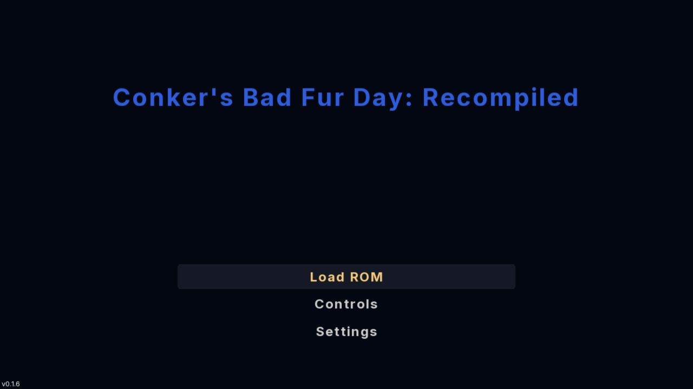</a>

     当前网页ROM启动器，未载入游戏文件 <a href="https://n64hub.com/conker/">图片来源</a>

     基于Conker重编译项目的独立网页移植，以成人幽默串联平台跳跃、探索和多种情境玩法。

     **平台：** Chrome / Edge 113+（WebGPU）；可按文档在Linux或Windows/WSL构建

     **运行：** 按README先在Linux/macOS或WSL运行build.sh完成重编译，再用Emscripten、naga和CMake构建host/build-web；也可打开在线启动器选取自己的ROM。 使用支持WebGPU的Chrome或Edge 113+；首次提示跨源隔离时刷新一次。

     **所需文件：** 自己的美版N64 ROM（.z64），SHA-1为4cbadd3c4e0729dec46af64ad018050eada4f47a。

     [**构建说明**](https://github.com/n64hub/CBFD-Recompiled-web/blob/main/README.md#the-web-page) · [项目源码](https://github.com/n64hub/CBFD-Recompiled-web) · [在线入口 · 查看文件要求](https://n64hub.com/conker/)

136. **Open Dark Colony**

     <a href="https://github.com/edulazaro/open-dark-colony/blob/main/README.md">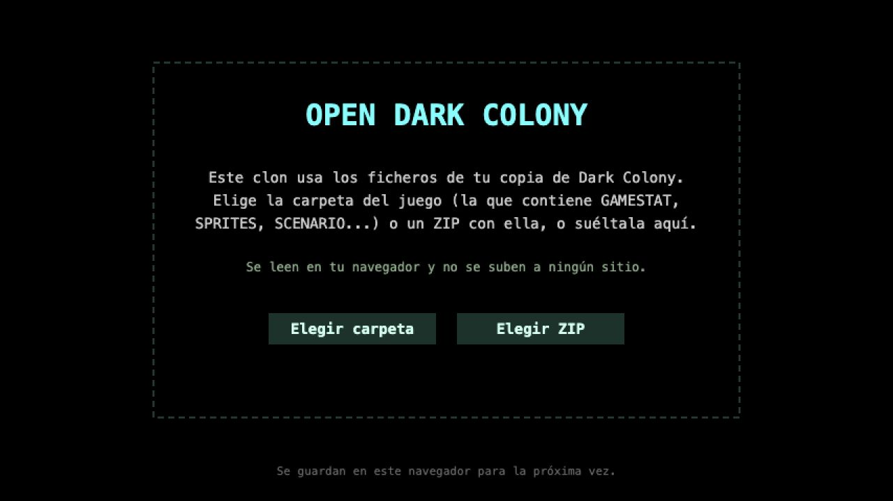</a>

     文件导入页 <a href="https://edulazaro.github.io/open-dark-colony/">图片来源</a>

     在浏览器中运行 Dark Colony 的即时战略重实现。项目使用原版文件提供的地图、单位与音效。

     **平台：** 浏览器（本地Node.js服务）

     **运行：** 安装项目要求的Node.js及依赖，执行npm run build与npm start，再导入自己的游戏目录或ZIP。

     **所需文件：** 自己的 Dark Colony 安装目录或 ZIP；页面会要求导入。

     [**构建说明**](https://github.com/edulazaro/open-dark-colony/blob/main/README.md) · [项目源码](https://github.com/edulazaro/open-dark-colony) · [在线入口 · 查看文件要求](https://edulazaro.github.io/open-dark-colony/)

137. **命令与征服：将军绝命时刻 · GeneralsX Web**

     

     上游提供的在线入口预览 <a href="https://github.com/SubmitGame/awesome-decomp-games/blob/9dd80506a67217df01af09ac1ca739a95b2f519a/screenshots/browser-command-conquer-generals-zero-hour.jpg">图片来源</a>

     基于EA公开源码与GeneralsX的WebGPU移植，提供基地建设与即时战略对战。

     **平台：** macOS构建；Chrome / Edge等支持WebGPU的浏览器运行

     **运行：** 按README准备Emscripten、CMake、Ninja及vcpkg，用webgpu预设构建引擎，再构建web目录并启动本地服务。

     **所需文件：** 需要自己的Zero Hour安装目录及.big资源；线上入口也要求自备文件。

     [**构建说明**](https://github.com/origami-ltd/wasm-generals) · [项目介绍](https://github.com/origami-ltd/wasm-generals) · [在线入口 · 查看文件要求](https://generals.wasm.ltd)

138. **微型法师 · Micro Mages Rust**

     

     项目提供的封面预览 <a href="https://github.com/HungLo2020/MicroMages/blob/main/README.md">图片来源</a>

     原生Rust玩法重建，操纵法师跳跃、射击并攀登关卡，可选择一至四名玩家。

     **平台：** Linux

     **运行：** 准备Rust、SDL2以及README列出的ALSA/udev和图形开发库，在项目目录运行cargo run。

     [**构建说明**](https://github.com/HungLo2020/MicroMages/blob/main/README.md) · [项目介绍](https://github.com/HungLo2020/MicroMages)

139. **魔兽世界：影牙城堡 · 单机演示**

     

     作者提供的单场景演示截图 <a href="https://github.com/wubing733-prog/wow-mobile-ios/blob/main/README.md">图片来源</a>

     使用Godot重建影牙城堡单场景的单机演示，提供移动、攻击与技能；角色模型为静态网格。

     **平台：** Windows；iOS需自行签名

     **运行：** 按构建说明解压仓库内压缩地形，用Godot 4.7.2导入并运行工程；iOS需按文档导出Xcode工程并签名。

     [**构建说明**](https://github.com/wubing733-prog/wow-mobile-ios/blob/main/docs/IOS-BUILD.md) · [项目介绍](https://github.com/wubing733-prog/wow-mobile-ios)

140. **班卓熊大冒险 · n64hub网页版**

     <a href="https://github.com/n64hub/BanjoRecomp-web/blob/main/BUILDING.md#the-web-page">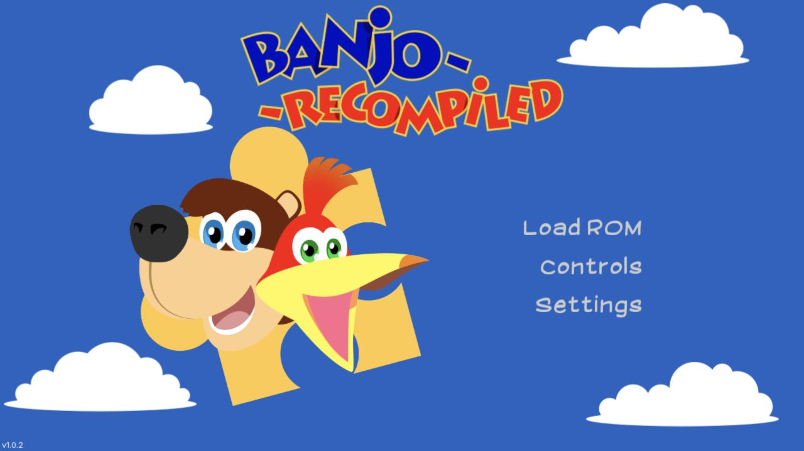</a>

     当前网页ROM启动器，未载入游戏文件 <a href="https://n64hub.com/banjo-kazooie/">图片来源</a>

     基于Banjo Recompiled的独立网页移植，操纵班卓与卡祖伊探索关卡、解谜并收集拼图。

     **平台：** Chrome / Edge 113+（WebGPU）；可按文档在Linux或Windows/WSL构建

     **运行：** 按BUILDING.md准备ROM与重编译工具，应用N64Recomp-browser补丁，再用Emscripten、naga、CMake和Ninja构建build-web；也可打开在线启动器选取自己的ROM。 使用支持WebGPU的Chrome或Edge 113+；首次提示跨源隔离时刷新一次。

     **所需文件：** 自己的北美1.0版N64 ROM。

     [**构建说明**](https://github.com/n64hub/BanjoRecomp-web/blob/main/BUILDING.md#the-web-page) · [项目源码](https://github.com/n64hub/BanjoRecomp-web) · [在线入口 · 查看文件要求](https://n64hub.com/banjo-kazooie/)

141. **塞尔达传说：姆吉拉的假面 · n64hub网页版**

     <a href="https://github.com/n64hub/Zelda64Recomp-web/blob/main/BUILDING.md#the-web-page">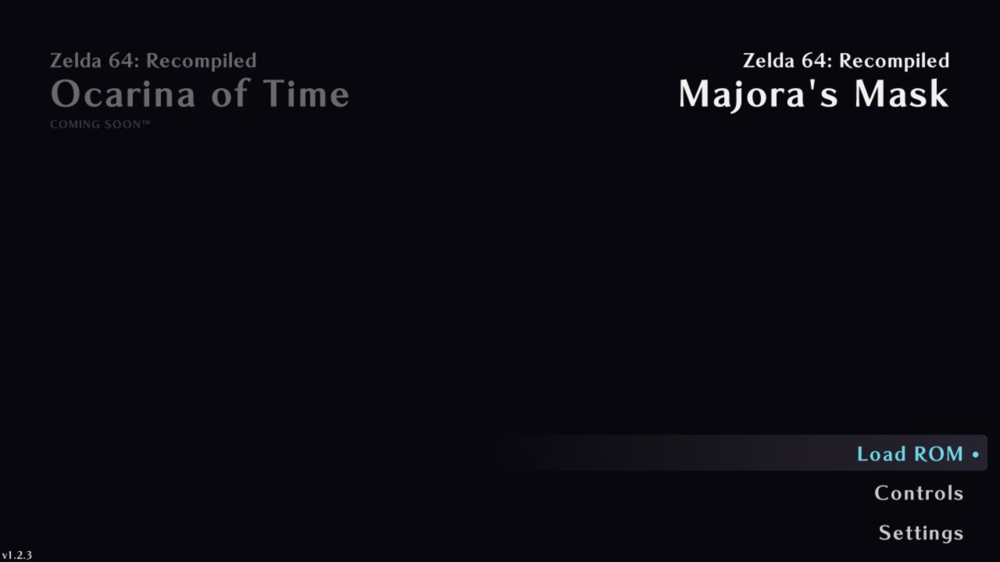</a>

     当前网页ROM启动器，未载入游戏文件 <a href="https://n64hub.com/majoras-mask/">图片来源</a>

     基于Zelda64Recomp的独立网页移植，在三日循环中探索时钟镇、变身解谜并攻略迷宫。

     **平台：** Chrome / Edge 113+（WebGPU）；可按文档在Linux或Windows/WSL构建

     **运行：** 按BUILDING.md准备ROM与重编译工具，应用N64Recomp-browser补丁，再用Emscripten、naga、CMake和Ninja构建build-web；也可打开在线启动器选取自己的ROM。 使用支持WebGPU的Chrome或Edge 113+；首次提示跨源隔离时刷新一次。

     **所需文件：** 自己的北美版N64 ROM；运行时使用未解压的原始镜像。

     [**构建说明**](https://github.com/n64hub/Zelda64Recomp-web/blob/main/BUILDING.md#the-web-page) · [项目源码](https://github.com/n64hub/Zelda64Recomp-web) · [在线入口 · 查看文件要求](https://n64hub.com/majoras-mask/)

142. **大金刚64 · n64hub网页版**

     <a href="https://github.com/n64hub/Donkey-Kong-64-Recompiled-web/blob/main/BUILDING.md#the-web-page">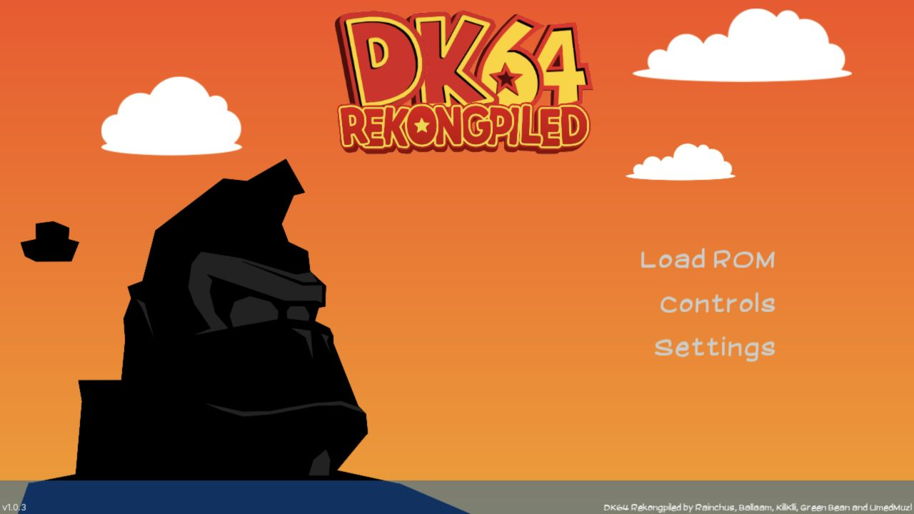</a>

     当前网页ROM启动器，未载入游戏文件 <a href="https://n64hub.com/donkey-kong-64/">图片来源</a>

     基于DK64 Recompiled的独立网页移植，切换金刚角色探索3D关卡，收集香蕉并完成挑战。

     **平台：** Chrome / Edge 113+（WebGPU）；可按文档在Linux或Windows/WSL构建

     **运行：** 按BUILDING.md准备ROM与重编译工具，应用N64Recomp-browser补丁，再用Emscripten、naga、CMake和Ninja构建build-web；也可打开在线启动器选取自己的ROM。 使用支持WebGPU的Chrome或Edge 113+；首次提示跨源隔离时刷新一次。

     **所需文件：** 自己的美版N64 ROM；运行时使用未解压的原始镜像。

     [**构建说明**](https://github.com/n64hub/Donkey-Kong-64-Recompiled-web/blob/main/BUILDING.md#the-web-page) · [项目源码](https://github.com/n64hub/Donkey-Kong-64-Recompiled-web) · [在线入口 · 查看文件要求](https://n64hub.com/donkey-kong-64/)

143. **暗黑破坏神2 · Rust/WASM原型**

     

     上游原型截图 <a href="https://github.com/shpaw415/diablo2-wasm">图片来源</a>

     在罗格营地进行移动、战斗与物品收集的浏览器原型，提供野蛮人、法师和圣骑士；并非完整游戏。

     **平台：** 桌面浏览器；本地构建需Rust与Python3

     **运行：** 构建d2game的WASM并用wasm-bindgen生成网页模块，从自己的安装中提取MPQ数据；在demo目录启动本地HTTP服务后打开menu.html。

     **所需文件：** 自己的Diablo II v1.12安装或安装MPQ数据；部分发行版的角色资源路径需要调整。

     [**构建说明**](https://github.com/shpaw415/diablo2-wasm/blob/master/README.md) · [项目源码](https://github.com/shpaw415/diablo2-wasm)

144. **国际象棋大师9000 · Chessmaster-Web**

     

     作者原帖项目预览 <a href="https://x.com/senguttuvang/status/2113518853649289638">图片来源</a>

     用3D棋盘重访Chessmaster 9000。公开工程提供引擎重建工具和浏览器界面，部分教学、音频及棋力等价仍不完整。

     **平台：** 桌面浏览器；已说明的构建平台为macOS ARM64

     **运行：** 准备Bun、uv、C编译器、Emscripten、Ghidra/JDK与Assimp，按README执行make setup、prepare-media和make dev；也可查看作者在线入口。

     **所需文件：** 自己的Chessmaster 9000已安装数据，且The King 3.23引擎须匹配README指定哈希。

     [**构建说明**](https://github.com/senguttuvang/Chessmaster-Web/blob/main/README.md) · [项目源码](https://github.com/senguttuvang/Chessmaster-Web) · [在线入口 · 查看文件要求](https://chessmaster9000.com/)

本合集只提供项目与体验链接，不托管原版程序或游戏资源。

原创整理文字采用 [MIT](LICENSE) 授权。第三方内容见[版权与来源](NOTICE.md)。
